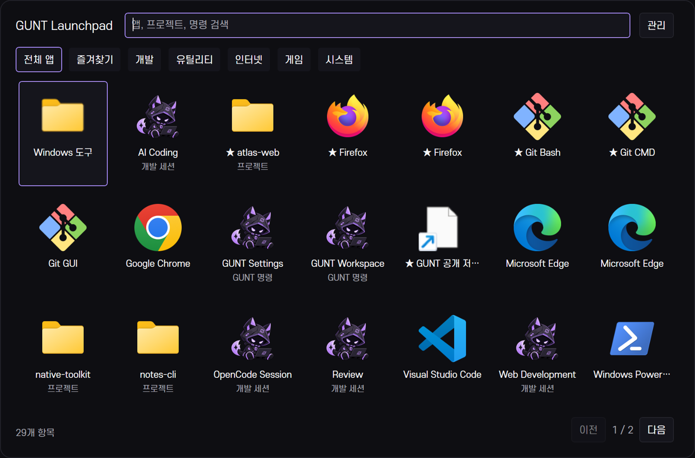
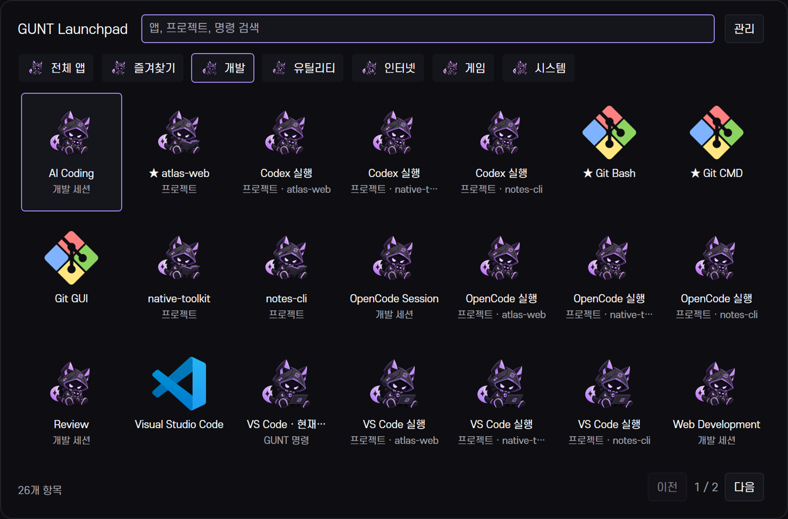
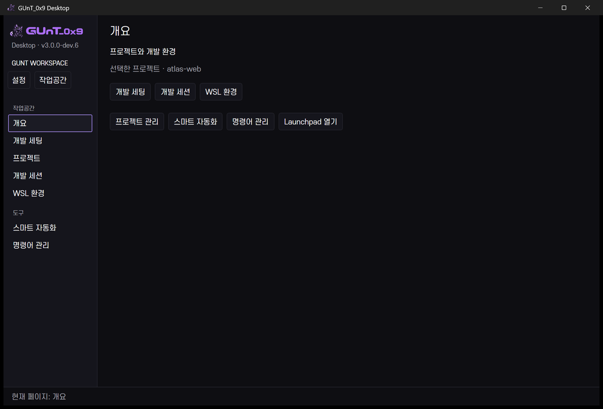

<p align="center">
  
</p>

# GUnT_0x9 Desktop

**Midnight Purple · Windows Developer Workspace**

Windows 데스크톱 꾸미기와 개발 작업공간을 연결하는 네이티브 앱입니다. GUNT Settings에서 데스크톱을 설정하고, Launchpad에서 앱을 실행·정리하며, Workspace에서 프로젝트·WSL 개발 도구·세션을 관리합니다. 한국어 상단 바와 빠른 패널은 기존 작업 문맥을 공유합니다.

[주요 기능](#주요-기능) · [최신 업데이트](#최신-업데이트) · [버전 기록](#버전-기록) · [빌드와 실행](#빌드와-실행) · [문서](#문서)

## 현재 버전

- **개발 프리뷰: 3.0.0-dev.6 — Application Reorganization**, `feat/v30-launchpad`.
- **main 공개 기준: v2.5 소스**. v2.6 기능 개발 이력은 `feat/v26-developer-workspace`에 보존합니다.
- 새 PC용 설치 패키지와 정식 3.0 배포는 준비되지 않았습니다. 이 저장소는 소스·설정 예시·검증 기록을 제공합니다.



실제 Windows 175% 화면입니다. 설치 앱의 공개 가능한 부분 목록과 별도 예제 프로젝트를 사용했습니다. 이름이 같아도 실행 인수·등록 정보가 다른 항목은 보존하므로 일부 브라우저가 두 번 보입니다. 개인 앱 목록·프로젝트·배경은 공개하지 않습니다.

## 주요 기능

- **GUNT Launchpad** — `Ctrl+Alt+L`로 여는 앱 그리드, 통합 검색·즐겨찾기·카테고리·폴더·드래그 정렬·사용자 바로가기. 원래 앱 아이콘이 기본이며 원하는 항목에 마스코트 포즈를 지정합니다. [사용법과 제한](docs/v30-launchpad.md)

- **데스크톱 꾸미기** — 한국어 WinForms 상단 바, Windows 작업 표시줄 기반 Dock, 설치된 Lively 배경 검색·즐겨찾기·화면별 배치. Dock 자동 적용은 현재 보류합니다.
- **개발 작업공간** — 프로젝트 탐색·즐겨찾기·최근 사용, 실제 Git 읽기 전용 정보, 프로젝트별 개발 기본값, WSL의 Codex·OpenCode와 VS Code·터미널 실행 요청.
- **빠른 도구** — 명령 팔레트의 별칭·검색·즐겨찾기, 현재 프로젝트를 공유하는 빠른 패널, 키보드 탐색. [실제 화면](docs/visual-history.md#dev2-빠른-도구)
- **시스템 모니터** — Rainmeter CPU·메모리·저장공간·네트워크와 독립 그래프. HWiNFO 온도는 공급자·단위·갱신 상태를 검사하며 누락값을 정상 수치로 대체하지 않습니다.
- **작업공간과 복구** — 프로필 차이 미리보기, 개발 세션의 단계 편집·실행 요약·개별 결과, 사용자가 켜는 자동화 규칙, 설정 체크포인트와 구성 요소별 복구.

외부 CLI를 시작했다는 결과는 로그인·대화·개발 서버 준비 완료를 뜻하지 않습니다. [개발 작업공간 사용법](docs/v26-developer-workspace.md)과 [세션 안내](docs/v26-development-sessions.md)를 참고하세요.

## 최신 업데이트

**3.0.0-dev.6 · 2026-10-20 · Application Reorganization · 개발 프리뷰**

- **Settings / Launchpad / Workspace**로 탐색을 구분하고 기존 페이지 링크·명령·프로젝트 데이터는 유지했습니다.
- dev.4의 앱 실행·정리 기반과 dev.5의 실제 포즈 10종을 연결했습니다. 미지정 앱에는 원래 아이콘을 유지합니다.
- 반복 관리 버튼을 메뉴로 모으고 행 높이·아이콘 영역을 맞췄습니다. 변경 없는 재열기는 기존 그리드를 재사용합니다.

| 선택형 마스코트 테마 | 개발 도구를 모은 Workspace |
|---|---|
|  |  |

동일 공개 카탈로그에서 각 3개 프로세스·21회 재열기를 비교했습니다. WPF 내부 재표시 중앙값은 **90.257→17.450ms**, 작업 집합은 **212.645→188.711MiB**였습니다. 키 입력부터 화면 합성 완료까지의 지연이나 OS 콜드 시작 수치는 아닙니다. 첫 시작의 큰 변동과 이전 후보의 퇴행도 [측정 기록](docs/v30-performance.md#launchpad-dev4--dev6--2026-10-20)에 공개합니다.

실제 전역 키·드래그·검증 앱 실행, 150/175% 두 화면 배치를 확인했습니다. 모든 패키지 앱 실행·다른 DPI·장시간 사용은 미검증입니다. 신규 그림은 공식 원본의 개발용 파생 자산이며 별도 사용자 승인까지 받은 것으로 표시하지 않습니다.

[전후 비교·10개 실제 화면](docs/visual-history.md#v300-dev4--dev6--gunt-launchpad) · [구현·검사 결과](docs/v30-launchpad-report.md) · [포즈와 출처](assets/branding/mascot/README.md) · [변경 기록](CHANGELOG.md)

## 버전 기록

### v2.4 — Desktop Foundation

**2026-10-16.** 한국어·공식 브랜딩, Rainmeter 시간축 그래프·실제 센서 연결, DPI별 위젯 배치와 WPF 설정·복구 기반을 정리했습니다. 충돌이 확인된 File Explorer Styler는 비활성 상태로 남겼습니다.

[당시 제어 센터](docs/images/v25-before-overview.png) · [구현 보고](docs/v24-report.md) · [검증·추가 수정](docs/v24-flicker-mods-report.md)

### v2.5 — UX Overhaul

**2026-10-17.** 실제 상태 행, 프로젝트 관리·Lively 갤러리, 프로필 미리보기와 미저장 보호·설정 복원을 추가했습니다. Dock 자동 적용은 보류 중입니다.

[제어 센터 화면](docs/images/v25-overview.png) · [개선 보고](docs/v25-ux-overhaul.md) · [검사 기록](docs/v25-testing.md)

### v2.6 — Developer Workspace

**2026-10-17–19 개발 기록.** 프로젝트 루트 탐색, WSL CLI 실행, 개발 세션, 공유 명령 팔레트·빠른 패널과 선택형 자동화를 통합했습니다. 외부 도구 인증·대화 완료와 실제 화면 재연결은 별도 검증 범위입니다.

[개발 세팅 화면](docs/images/v26-developer-setup.png) · [기능·사용법](docs/v26-developer-workspace.md) · [검증·화면 모음](docs/v26-testing.md)

### v3.0.0-dev.1 — UI Foundation

**2026-10-19.** 공통 디자인 리소스, 목적별 탐색, 적응형 개발 화면과 작은 팝업의 기반을 정리했습니다. 최초 작업 시에는 소스 검사·교차 컴파일까지만 확인했으며 Windows 화면 검증은 dev.2 작업 중 이어 수행했습니다.

[보존 빌드의 실제 화면](docs/images/releases/v3.0/dev.1/developer-setup.png) · [시각 변천사](docs/visual-history.md) · [디자인 시스템](docs/v30-ui-design-system.md)

### v3.0.0-dev.2 — Visual Completion

**2026-10-19.** 프로젝트 탐색기·본문 세션 편집기·적응형 배경 그리드를 구현하고 실제 Windows GUI·175% 배율을 확인했습니다. 정식 3.0 전체 완료를 의미하지 않습니다.

[공개 화면 모음과 전후 비교](docs/visual-history.md) · [개발 보고](docs/v30-ui-overhaul.md) · [실제 검증 범위](docs/v30-screenshots.md)

### v3.0.0-dev.3 — UI Polish & Optimization

**2026-10-20.** 작은 창의 주요 동작과 보조 편집창을 정리하고 세션 행·갤러리 템플릿을 재사용했습니다. 실제 Windows 빌드·175% 화면·WPF 상호작용 42개·OS 키 입력/상단 바 통합 15개를 확인했습니다. 정식 3.0 또는 모든 환경의 시각 완성을 뜻하지 않습니다.

[실제 화면·전후 비교](docs/visual-history.md#v300-dev3--ui-polish--optimization) · [결과 보고](docs/v30-dev3-report.md) · [전후 측정](docs/v30-performance.md)

### v3.0.0-dev.4 — Launchpad Foundation

**2026-10-20.** 앱 그리드·키보드·설치 앱 발견·즐겨찾기·카테고리·폴더·정렬과 로컬 설정 기반을 구현했습니다. [실제 초기 화면과 검증 범위](docs/v30-launchpad.md).

### v3.0.0-dev.5 — Mascot Experience

**2026-10-20.** 기존 승인 코딩 포즈와 새 파생 포즈 9종, 크기별 투명 아이콘·선택형 테마·누락 시 원래 아이콘 복귀를 통합했습니다. [자산 검수표](assets/branding/mascot/README.md) · [구현 상태](docs/v30-launchpad.md).

### v3.0.0-dev.6 — Application Reorganization

**2026-10-20.** Settings/Workspace 탐색 분리, 기존 명령 연결, 실제 단축키 호스트·마우스 정렬·두 화면 검증과 재열기 컨트롤 재사용을 마쳤습니다. 3.0 정식 출시는 아닙니다. [실제 화면·비교](docs/visual-history.md#v300-dev4--dev6--gunt-launchpad) · [최종 검증과 미완료 항목](docs/v30-launchpad-report.md).

## 빌드와 실행

검증 환경은 **Windows 11, Windows PowerShell 5.1, .NET Framework 4.8**입니다. 기존 Framework C# 컴파일러를 사용하며 Electron·Node.js 기반 UI 도구는 필요하지 않습니다.

이 저장소는 기존 사용 환경의 소스 스냅샷입니다. 타사 설치본·개인 설정·백업·배경 원본은 포함하지 않습니다. 먼저 [PC별 설정 예시](config/examples/README.md)를 확인하세요. 자리표시자는 앱이 자동 치환하지 않으므로 실제 설치 경로와 센서 구성을 준비해야 합니다.

앱 창을 닫은 뒤 프로젝트 루트의 Windows PowerShell에서 순서대로 실행합니다. 상단 바 빌드는 센서 DLL도 생성합니다.

```powershell
.\scripts\build-configuration.ps1
.\scripts\build.ps1
.\scripts\build-control-center.ps1
& .\bin\GUNT.ControlCenter.exe (Get-Location).Path settings
```

`build.ps1`은 실행 중인 프로젝트 상단 바를 교체할 수 있습니다. Explorer를 자동 재시작하지 않습니다. WSL에서 Windows PE 자동 실행이 등록되지 않은 경우의 실행 방법은 [Windows 검증 안내](docs/v30-screenshots.md#실행-명령)를 따릅니다. 새 PC 일괄 설치·SDK 방식 빌드는 별도 검증 대상입니다.

전역 키는 기존 상단 바가 등록합니다. 이미 실행 중이면 중복 실행하지 않습니다. 상단 바가 없다면 `& .\bin\GUNT-Bar.exe (Get-Location).Path`로 시작합니다. 독립 UI는 다음처럼 열 수 있습니다.

```powershell
& .\bin\GUNT.ControlCenter.exe (Get-Location).Path launchpad
& .\bin\GUNT.ControlCenter.exe (Get-Location).Path workspace
```

## 실험·호환성 안내

- **Dock 자동 적용 보류**, **File Explorer Styler 비활성**을 유지합니다. 원인 미확정인 과거 Explorer 교체를 해결 완료로 표시하지 않습니다.
- 자동화 규칙은 기본 중지 상태이며 사용자가 켭니다. 모든 전원·앱·화면 조합을 검증한 것은 아닙니다.
- dev.6 Launchpad는 연결 화면 두 개의 150%·175%와 음수 좌표를 확인했습니다. dev.3 과거 캡처는 화면 한 개·175%였습니다. 100/125/200%, 재연결, 고대비·스크린리더, 재로그인·장시간 사용은 후속 범위입니다.
- 설치 앱 등록을 항상 감시하지 않습니다. 수동 다시 검색과 24시간 캐시를 사용합니다. 패키지 등록 조회 지원이 모든 Store 앱의 실행 검증을 뜻하지 않습니다.
- HWiNFO 설치·공급자 갱신·개별 장치 연결과 WSL 도구 설치·인증은 해당 PC에서 준비해야 합니다.

문제가 생기면 [v2.6 구성 요소 복구](docs/v26-recovery.md), [제어 센터·설정 복구](docs/v25-recovery.md), [Windhawk 복구](docs/windhawk-recovery.md)를 확인하세요. 다른 PC의 과거 체크포인트를 그대로 적용하지 마세요.

## 구조

C# WinForms 상단 바와 WPF/.NET Framework 4.8 제어 센터가 기존 개발 서비스·JSON 설정을 공유합니다. Rainmeter는 측정 표시, Windhawk는 Windows UI 조정, Lively는 배경 재생을 담당합니다. Flow Launcher·Windows Terminal·PowerShell·WSL은 기존 설치와 연결합니다.

`src/` · `control-center/` · `rainmeter/` · `windhawk/` · `scripts/` · `config/` · `assets/` · `docs/`

[기반 구조](docs/v24-architecture.md) · [개발 작업공간 구조](docs/v26-developer-workspace.md) · [UI 설계](docs/v30-ui-design-system.md)

## 다음 개발

다른 DPI·접근성·장시간 사용 검증과 초기 구성·메모리의 남은 비용을 먼저 검토합니다. 아직 구현하지 않은 다음 기능은 현재 기능 목록에 포함하지 않습니다.

[실제 v3.0 로드맵](docs/v30-roadmap.md)

## 문서

- [Launchpad 구현·검증](docs/v30-launchpad-report.md) · [사용법](docs/v30-launchpad.md)
- [변경 기록](CHANGELOG.md) · [버전별 시각 기록](docs/visual-history.md) · [공개 이미지 출처·검토 목록](docs/images/releases/manifest.json)
- [v2.4 보고·검증](docs/v24-report.md) · [v2.5 UI 보고](docs/v25-ux-overhaul.md) · [v2.6 검증](docs/v26-testing.md)
- [dev.2 UI 결과](docs/v30-ui-overhaul.md) · [화면 검증](docs/v30-screenshots.md) · [성능 결과](docs/v30-performance.md)
- [개발 세션](docs/v26-development-sessions.md) · [명령·빠른 패널](docs/v26-command-palette.md) · [자동화](docs/v26-automation.md)
- [설정 예시](config/examples/README.md) · [탐색·설정 형식](docs/v25-navigation.md) · [센서·한글 표시](docs/monitor-korean-fix.md)
- [공식 브랜딩](docs/branding-integration.md) · [Windhawk 결과](docs/windhawk-enhancement-report.md) · [호환성표](windhawk/compatibility-matrix.md)
- [v2.4 복구](docs/v24-recovery.md) · [v2.5 복구](docs/v25-recovery.md) · [v2.6 복구](docs/v26-recovery.md)
- [공개 저장소 구성](docs/repository-publishing.md) · [README·릴리스 이미지 유지관리](docs/readme-maintenance.md)

## 크레딧과 라이선스

공식 로고·마스코트는 승인된 [브랜드 자산](assets/branding/README.md)을 사용합니다. 로고 재생성은 기존 `scripts/prepare-branding.py`와 Pillow·NumPy·SciPy 환경을 사용하며 [브랜딩 문서](docs/branding-integration.md)에 절차가 있습니다.

Rainmeter·Windhawk·Lively·Flow Launcher·HWiNFO와 각 Windhawk 모드의 원래 저작권·설치·라이선스 조건을 따릅니다. [아이콘 라이선스](assets/icons/LICENSE.txt), [S-Core Dream 안내](assets/fonts/S-Core-license.txt), [Manrope OFL](assets/fonts/Manrope-OFL.txt)를 보존합니다. 별도의 프로젝트 전체 라이선스를 새로 지정하지 않았습니다. 타사 프로그램 설치본과 사용자 배경 원본은 재배포하지 않습니다.
