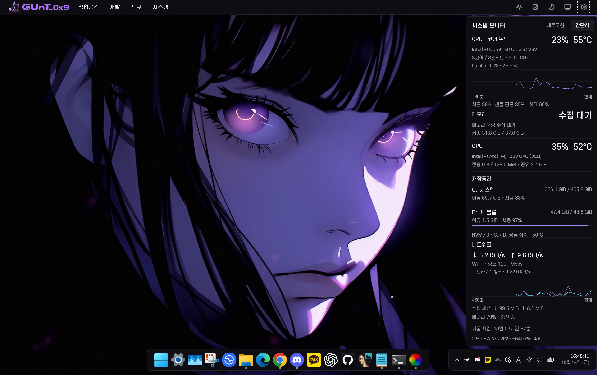

<p align="center">
  
</p>

# GUnT_0x9 Desktop

**Midnight Purple · Windows 11 개발자 데스크톱**

네이티브 Windows 작업 표시줄과 시스템 기능을 유지하면서, 한국어 명령 바·실시간 시스템 모니터·배경화면 제어·WPF 제어 센터를 연결한 개인 데스크톱 커스터마이징 프로젝트입니다. 현재 개발 버전은 **3.0.0-dev.2 Visual Completion**입니다. 게시된 v2.5는 `main`, v2.6 기능 기준은 `feat/v26-developer-workspace`에 보존하고 UI 작업은 `feat/v30-ui-foundation`에서 진행합니다.

## 3.0.0-dev.2 — UI 시각 완성

프로젝트의 유형·실제 Git 상태·최근 사용·행 내부 즐겨찾기, 본문 세션 단계 편집기, 적응형 가상화 배경 그리드를 구현했습니다. 기존 WPF/.NET Framework 4.8과 v2.6 실행 서비스를 유지합니다.

실제 Windows에서 빌드·실행하고 주요 화면 10개와 세 가지 창 크기를 **175% 배율**로 검토했습니다. 격리된 WPF 상호작용 검사와 dev.1/dev.2 각각 5회 교차 성능 측정을 수행했습니다. 프로젝트 페이지 초기 구성 중앙값은 이번 표본에서 54.8→44.1ms였습니다. 세션·갤러리 구성 비용과 약 3MiB의 메모리 증가도 함께 기록했습니다.

정식 3.0 출시 완료를 의미하지 않습니다. 다른 DPI·물리 다중 화면·스크린리더·장시간 성능은 추가 검증 대상입니다. 아래 v2.x 이미지는 이전 버전 기록이며 dev.2 증거와 구분합니다.

[구현 결과](docs/v30-ui-overhaul.md) · [디자인 시스템](docs/v30-ui-design-system.md) · [실제 화면 검증·실행 명령](docs/v30-screenshots.md) · [측정 결과](docs/v30-performance.md) · [로드맵](docs/v30-roadmap.md)

## v2.6 Developer Workspace

**프로젝트 선택 → WSL + Codex / OpenCode / VS Code**를 정확한 폴더에서 시작합니다.

- 프로젝트 루트·깊이 제한 탐색, 기존 프로젝트 목록 공유, 즐겨찾기·최근 사용·전역/프로젝트별 기본값.
- 실제 WSL 배포판·일반 사용자·도구 확인, 한글/공백/특수문자 경로 검증, Windows Terminal/CMD의 대화형 CLI.
- 편집 가능한 개발 세션·실행 전 요약·개별 결과·이전 실행 구성·중복 시작 방지.
- 공유 명령 레지스트리·별칭·즐겨찾기, **Ctrl+Alt+Space** 명령 팔레트, 상단 바 브랜드 메뉴의 **빠른 패널**.
- 선택 시 조회하는 읽기 전용 Git 상태와 WSL 도구 버전. 사용자가 켜는 자동화 규칙·cooldown·수동 변경 보호.

[사용 방법·설정 형식](docs/v26-developer-workspace.md) · [개발 세션](docs/v26-development-sessions.md) · [명령·빠른 패널](docs/v26-command-palette.md) · [자동화](docs/v26-automation.md) · [검사·미검증 범위](docs/v26-testing.md) · [복구](docs/v26-recovery.md)


## v2.5 UX 개선

- Dock·프로젝트 전용 목적지와 14개 페이지, 미저장 변경 보호, 적용 요약·실행 취소.
- 실제 상태 행, 프로필 차이 미리보기·사용자 프리셋·이전 상태 1회 복원.
- 프로젝트 관리·검색·고정·최근 실행, 설치된 Lively 배경 갤러리와 화면별 배치 정보.
- 센서 연결 안내, 선택 설정 스냅샷 복원, 개인정보를 가린 진단 내보내기.
- 제어 센터 내부 Ctrl+K 명령 찾기, Ctrl+S 적용, 작은 창·키보드 포커스 개선.

**Dock 자동 적용은 보류 중입니다.** 적용 시험 뒤 Explorer 프로세스 교체가 관찰됐고 원인은 확인되지 않았습니다. 기존 Dock을 원래 값으로 복원했으며, 안전 보류가 있는 PC에서는 Dock 페이지가 현재 값과 Windhawk 열기만 제공합니다. 충돌이 있었던 File Explorer Styler는 비활성 상태를 유지합니다.

[구현 결과·화면](docs/v25-ux-overhaul.md) · [탐색·데이터 형식](docs/v25-navigation.md) · [실제 검사와 제한](docs/v25-testing.md) · [구성 요소 복구](docs/v25-recovery.md) · [v2.6 기능 범위](docs/v26-feature-expansion.md)


## 실제 적용 화면



2026-10-16 사용자가 제공한 실제 적용 화면입니다. 화면 속 배경은 현재 선택된 배경이며, 배경화면 원본·영상은 저장소에 포함하지 않습니다. 메모리의 ‘수집 대기’ 등 화면에 나타난 상태를 성공 값으로 바꾸거나 숨기지 않았습니다.

## 구현된 기능

- **한국어 상단 바**: 공식 마스코트·워드마크, 작업공간/개발/도구/시스템 메뉴, 모니터·배경·집중·화면·설정 빠른 동작.
- **분리형 Dock**: Windows 앱 실행·창 전환·고정 앱을 보존한 낮은 앱 Dock과 네이티브 트레이·한국어 날짜·초 시계.
- **Rainmeter 시스템 모니터**: CPU·RAM·GPU·C:/D: 저장공간·네트워크·배터리·가동 시간. CPU/네트워크 그래프를 독립 표시하고 시간축·스케일을 관리합니다.
- **실제 하드웨어 센서**: HWiNFO가 보고한 CPU/GPU/NVMe 온도를 연결합니다. 누락되거나 오래된 값을 0°C로 대체하지 않습니다.
- **배경·프로필**: 기존 Lively 선택 보존, 재생/정지·정적 대체·개발/일상/게임/집중 프로필.
- **멀티 모니터·DPI**: 안정적인 화면 식별자, 음수 좌표, 배율별 위젯 위치 저장·복원.
- **GUnT_0x9 제어 센터**: WPF/.NET Framework 4.8, 설정·센서·배경·시작 복원·진단·실제 Windhawk 모드 목록과 복구.
- **시작·복구**: 중복 실행 방지, 제한된 재시도, 체크포인트와 구성 요소별 복구 스크립트.

## 제어 센터


공식 로고는 승인된 PNG에서 생성한 자산입니다. 작은 앱 아이콘은 마스코트만 사용하고, 상단 바에는 가로형 브랜드 로고를 사용합니다. 소스 PNG와 16–256px 아이콘, 다중 해상도 ICO를 함께 보관합니다.

## 검증 환경

| 항목 | 확인한 환경 |
|---|---|
| Windows | Windows 11 Home 25H2, 26200.9711 |
| 화면 | 기존 3대 기록, v2.5 최종 검증 시 1대 연결 · 2880×1800 / 175% |
| Rainmeter | 4.5.28.3936 |
| Windhawk | 1.7.3 portable, 설치 14개 / 활성 13개 |
| Flow Launcher | 2.1.4 |
| Lively | 2.2.1.0 |
| UI 글꼴 | S-Core Dream, Manrope |

이 표는 해당 PC의 검증 기록입니다. 다른 하드웨어와 Windows 업데이트 이후의 호환성을 보장하지 않습니다.

## 소스 구조

```text
assets/branding/  공식 로고 원본·아이콘·워드마크
assets/fonts/     UI 글꼴과 라이선스 안내
src/              WinForms 상단 바·센서·설정 처리
control-center/   WPF 제어 센터
rainmeter/        시스템 모니터 스킨과 Lua
windhawk/         공식 모드 소스·설정·호환성표
scripts/          빌드·설정·복구·실제 UI 검증
config/           공통 디자인 설정과 PC별 설정 예시
docs/             구현·검증·복구 기록과 적용 화면
```

## 빌드와 실행 범위

이 저장소는 기존 사용 환경에서 이어 개발한 **소스 및 설정 스냅샷**입니다. 타사 프로그램 설치본, 개인 백업·로그, PC별 경로·센서 설정, 배경화면 원본은 제외했습니다. 새 PC용 원클릭 설치 패키지는 아직 검증하지 않았습니다.

Windows에서 .NET Framework 4.8과 해당 PC 설정이 준비된 경우 프로젝트 폴더의 PowerShell에서 빌드합니다.

```powershell
.\scripts\build-configuration.ps1
.\scripts\build-control-center.ps1
.\scripts\build.ps1
```

제어 센터는 빌드 전 닫아야 합니다. `build.ps1`은 프로젝트 상단 바를 교체하므로, 빌드 후 기존 시작 복원 또는 상단 바 실행 절차를 사용합니다. Explorer를 자동 재시작하지 않습니다. PC별 설정은 [설정 예시](config/examples/README.md)를 참고하세요.

로고 재생성은 Python의 Pillow·NumPy·SciPy 환경에서 실행합니다.

```bash
python scripts/prepare-branding.py --root .
```

## 검증과 남은 제한

- 실제 시작 메뉴 검색·앱 실행, 탐색기 파일 작업·탭·검색, 달력·빠른 설정, Dock 앱 전환·초 시계, 제어 센터 탐색·공식 아이콘 리소스를 검사했습니다.
- 시스템 모니터 간단히/자세히는 숨김 실행으로 전환하며, 이전 실제 클릭 시험에서 가시 콘솔 이벤트 0건을 확인했습니다.
- File Explorer Styler는 XAML diagnostics 충돌 때문에 비활성 상태입니다. 기본 어두운 탐색기를 유지합니다.
- Windhawk 확장 작업 중 Explorer 교체 1회가 발생했습니다. 원인은 미확정이며 최근 Dock 자동 폭 표현식을 철회했습니다. 최종 검증은 기존 폭 계산 방식으로 수행했습니다.
- 재부팅·재로그인·장시간 배터리·모든 PC의 센서·Alt+Tab 아이콘의 별도 시각 검증은 완료로 표시하지 않습니다.
- 과거 문서의 `logs/`, `state/`, `backups/`, `screenshots/` 경로는 해당 PC의 로컬 검증 자료입니다. 공개 이미지에는 이 페이지의 명시적 첨부 파일만 포함합니다.

## 문서

- [공식 로고 통합](docs/branding-integration.md)
- [Windhawk 확장 결과](docs/windhawk-enhancement-report.md) · [모드 호환성표](windhawk/compatibility-matrix.md)
- [Windhawk 복구](docs/windhawk-recovery.md) · [v2.4 복구](docs/v24-recovery.md)
- [v2.4 구현 보고](docs/v24-report.md) · [검증 기록](docs/v24-testing.md)
- [한국어 표시 수정](docs/monitor-korean-fix.md) · [숨김 실행과 모드 추가](docs/v24-flicker-mods-report.md)
- [공개 저장소 구성](docs/repository-publishing.md) · [변경 기록](CHANGELOG.md)

## 외부 구성 요소

Rainmeter·Windhawk·Lively·Flow Launcher·HWiNFO는 각 프로젝트의 설치 및 라이선스 조건을 따릅니다. Windhawk 모드 소스의 원래 저작권·라이선스 헤더, 글꼴의 배포 안내를 보존했습니다. 타사 프로그램 설치본과 사용자 배경 원본을 재배포하지 않습니다.
