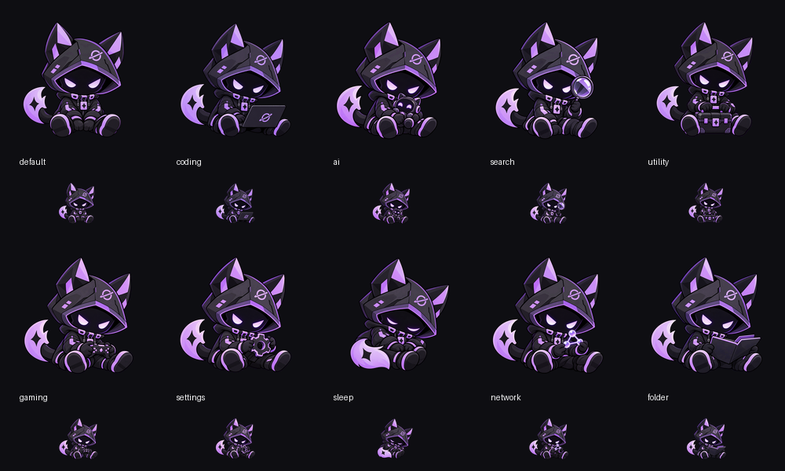

# Launchpad 마스코트 포즈

기존 승인 마스코트 `../icons/gunt-mascot-master.png`의 검은 고양이 귀 후드·라벤더 눈·궤도 문양·의상·꼬리를 기준으로 만든 개발 프리뷰 자산이다. 원본 공식 로고·아이콘은 교체하지 않는다. 새 파생 포즈의 별도 사용자 승인까지 받은 것으로 표시하지 않는다.

| ID | 실제 포즈 | 제작 근거 |
|---|---|---|
| default | 정면 중립 자세 | imagegen 개별 참조 생성 |
| coding | 노트북을 사용하는 자세 | 기존 승인 원본 재사용 |
| ai | 작은 로봇을 든 자세 | imagegen 개별 참조 생성 |
| search | 돋보기를 든 자세 | imagegen 개별 참조 생성 |
| utility | 공구함을 든 자세 | imagegen 개별 참조 생성 |
| gaming | 게임패드를 든 자세 | imagegen 개별 참조 생성 |
| settings | 톱니바퀴를 든 자세 | imagegen 개별 참조 생성 |
| sleep | 웅크려 쉬는 자세 | imagegen 개별 참조 생성 |
| network | 연결된 노드를 살피는 자세 | imagegen 개별 참조 생성 |
| folder | 폴더를 펼친 자세 | imagegen 개별 참조 생성 |

각 폴더의 `master.png`는 메타데이터를 제거한 1024px RGBA 원본이며 32/48/64/128/256px PNG를 제공한다. 실제 투명 영역과 비율을 유지하고 보이는 영역을 캔버스 84% 안에 맞췄다. 동일 그림에 다른 이름을 붙이지 않았다. `manifest.json`은 입력·마스터·크기별 해시와 처리 근거를 기록한다.

## 재현과 생성 프롬프트

그림 제작은 내장 `imagegen` 도구를 사용했다. 단일 승인 원본을 참조하여 **각 포즈마다 별도 호출**했다. 공통 프롬프트는 다음과 같다.

> Single transparent desktop launcher mascot icon. Reference is the approved official GUNT mascot; preserve its angular black hood, cat ears with lavender interiors, hidden black face and lavender eyes, orbital hood emblem, dark clothing and boots with purple trim, purple-accent tail, chibi silhouette and clean shaded illustration style. Single full-body character centered on square transparent canvas, clear padding, recognizable at 64px. No text, watermark, background or extra characters. Faithful variation, not a redesign.

이 공통 조건 뒤에 표의 포즈별 소품·자세를 명시했다. utility는 작은 공구함, AI는 작은 로봇, search는 돋보기, gaming은 게임패드, settings는 톱니바퀴, sleep은 감은 눈과 웅크린 자세, network는 연결 노드, folder는 열린 폴더를 지시했다. default는 소품 없는 정면 중립 자세다. 원본 생성 결과와 파생 자산의 입력 해시는 manifest로 구분한다.

내보내기는 Python/Pillow의 `scripts/prepare-mascot-icons.py --inputs <로컬 입력 JSON>`을 사용한다. 입력은 `{ "default": "/absolute/generated.png", "coding": "approved", ... }` 형태이며 실제 생성 파일은 자동 생성하지 않는다. 생성은 비결정적이므로 같은 프롬프트의 재실행이 같은 픽셀을 보장하지 않는다.

원래 앱 아이콘이 기본이다. 사용자가 앱/카테고리에 포즈를 지정하고 마스코트 테마를 켰을 때 사용한다. 파일이 없으면 원래 앱 아이콘으로 돌아간다. 하이브리드 배지는 아직 제공하지 않는다. 눈 깜빡임 프레임을 만들었다고 주장하지 않으며 90/110ms opacity 전환만 제공한다.
