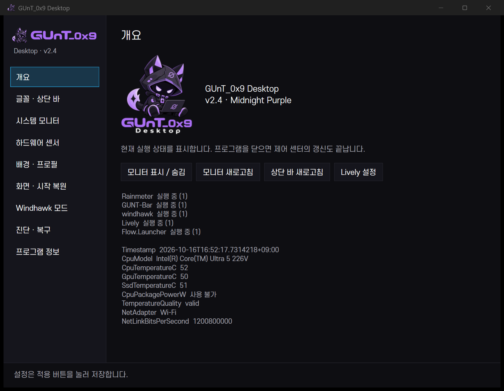
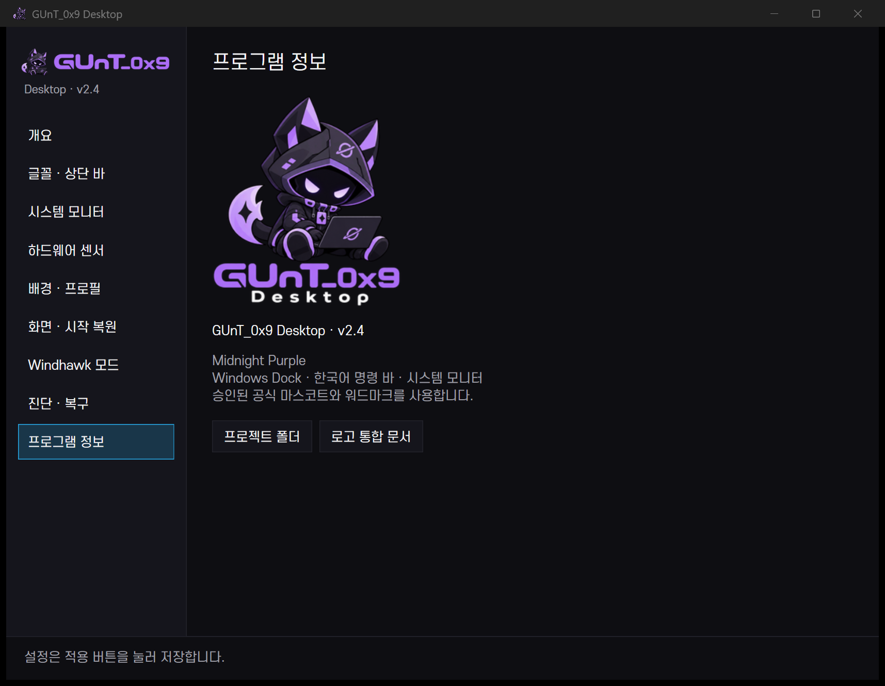

# GUnT_0x9 Desktop — 공식 로고 통합 결과

## 1. 공식 로고 자산

승인된 원본은 `assets/branding/source/gunt-logo-original.png`에 바이트 그대로 보관했다. 원본 1254×1254 RGBA, SHA256 `34b8e30432713acdfb953d70427aaed9186cc24e262620d583a2a1195d5f9e13`. 마스코트를 다시 생성하거나 벡터 원본으로 표시하지 않았다.

| 용도 | 파일 |
|---|---|
| 마스코트만 | `icons/gunt-mascot-master.png` |
| Windows 다중 해상도 | `icons/gunt-app.ico` — 16/24/32/48/64/128/256px |
| 각 크기 PNG | `icons/gunt-app-{size}.png` |
| 원본 워드마크 | `wordmark/gunt-wordmark.png` |
| 마스코트+워드마크, Desktop 제외 | `wordmark/gunt-logo-compact.png` |
| 전체 로고 | `full/gunt-logo-full.png`, `gunt-logo-full-160.png`, `gunt-logo-full-240.png` |
| 어두운 바탕 제시용 | `full/gunt-logo-dark-surface.png` |
| 검수표·해시 | `previews/icon-contact-sheet.png`, `manifest.json` |

상대 경로 기준은 `assets/branding/`이다. 투명 전체 로고와 원본을 유지하며, 어두운 바탕 제시용 변형만 불투명이다.

## 2. 적용 위치

- WinForms 상단 바: 승인된 원본 워드마크+마스코트 가로형 이미지. 기존 높이 42DIP, 한국어 메뉴와 빠른 동작 유지.
- 상단 바 자체 NotifyIcon: 기존 G 글자 대신 마스코트 ICO. Windows 기본 트레이 아이콘은 변경하지 않음.
- WPF 제어 센터: 창 제목 `GUnT_0x9 Desktop`, 내비게이션 가로 로고, 개요 전체 로고, 프로그램 정보 페이지.
- 프로그램 정보의 버전은 `config/theme.json`의 실제 `version` 2.4를 읽는다. 임의 릴리스 날짜·버전 생성 없음.
- 제어 센터 시작 메뉴 바로가기 1개 등록. 기존 타사 앱 바로가기·고정 앱·바탕화면은 유지.

기존 `GUNT-Desktop` 경로·GUNT.ControlCenter/GUNT-Bar 실행 파일명·mutex·레지스트리 이름은 보존했다. 상단 바의 숨겨진 창 식별 제목은 기존 메시지 전송·자동 복원 호환성을 위해 유지했다. 사용자에게 보이는 브랜드와 접근성 이름은 새 표기다.

## 3. Windows 앱 아이콘

`build-control-center.ps1`과 `build.ps1`에 `/win32icon`을 지정했다. WPF 프로젝트에도 `ApplicationIcon`을 설정하고 실제 창의 `Icon`을 마스코트 PNG로 지정했다. 두 EXE의 RT_ICON 7개가 원본 ICO 각 프레임 SHA256과 일치했다. 실제 WM_GETICON으로 창 아이콘을 추출했고 새 이름의 네이티브 taskbar 버튼을 확인했다.

기존 제어 센터 바로가기가 없어 시작 메뉴에 하나 생성했다. 대상은 기존 `bin/GUNT.ControlCenter.exe`, 인수는 실제 프로젝트 루트와 overview이다. 타사 앱 대상·인수·아이콘 변경 없음. 바탕화면 바로가기·추가 splash·설치 마법사·웹사이트는 새로 만들지 않았다.

Alt+Tab과 숨김 트레이 팝업에서의 별도 시각 검증은 미완료다. 실행 파일과 실제 창 아이콘을 검증한 사실로 이를 대신 통과 표시하지 않는다.

## 4. 상단 바

`GUnT_0x9`의 접근성 이름과 승인된 가로형 로고를 사용한다. 브랜드 이미지가 기존 GUNT 메뉴를 열며 중복 메뉴를 추가하지 않았다. 175%에서 메뉴명·브랜드·빠른 동작을 확인했다. 실제 다섯 메뉴를 열어 항목이 유지되는 것을 검사했다.

## 5. Control Center

개요·설정·Windhawk 목록·프로그램 정보로 실제 탐색했다. 변경된 제목에서도 기존 mutex를 유지해 두 번째 실행이 기존 창으로 이동하는 것을 확인했다. 설정 값은 시험을 위해 바꾸지 않았다.





다른 앱이 겹친 전체 화면 진단 캡처는 공개 자료로 사용하지 않았다. 위 이미지는 PrintWindow로 제어 센터 창만 캡처했다.

## 6. 이미지 품질

원본 RGB를 다시 그리지 않았다. alpha 64 초과 연결 성분을 기준으로 500px 미만의 분리 잡티를 제거하되 경계 2px를 보존했다. 고정 crop 좌표와 제거 픽셀 수는 manifest에 기록했다. 후드·귀·눈·꼬리·노트북·주요 색상은 유지했다. 워드마크와 흰 Desktop도 원본에서 추출했다.

Premultiplied-alpha LANCZOS로 각 크기를 원본 마스코트에서 개별 생성했다. 일곱 PNG를 실제 ICO 프레임으로 패키징했다. 검수표에서 어두운/밝은 표면, 원래 크기와 확대를 확인했다. 16px는 실루엣·밝은 귀/꼬리 중심으로 식별되며 의상 세부를 읽는 용도가 아니다. 완전 투명 여백을 검증했으며 원본의 미세한 윤곽 특성은 과도하게 재구성하지 않았다.

## 7. 테스트

| 결과 | 항목 |
|---|---|
| 검증 | 원본 해시·alpha·ICO 7개 실제 프레임·두 EXE 내장 프레임 SHA256 |
| 검증 | WPF 실행·새 제목·로고 접근성 이름·설정/모드/정보 탐색·단일 인스턴스 |
| 검증 | 새 이름의 작업 표시줄 버튼·WM_GETICON·바로가기 대상/인수/아이콘 |
| 검증 | 브랜드 메뉴·작업공간·개발·도구·시스템 실제 드롭다운 |
| 검증 | 기존 PS 구문·설정 범위·트랜잭션 실패 복구·센서 결측/정체성 검사 |
| 검증 | 브랜딩 중 Explorer PID 28864 유지 |
| 부분 | 작업 표시줄 아이콘은 native 앱 버튼과 창 아이콘으로 확인, 별도 확대 캡처 없음 |
| 미시험 | Alt+Tab·숨김 트레이의 별도 시각 확인, 실제 전체 브랜드 롤백 |
| 해당 없음 | 자체 설치 마법사·기존 splash·프로젝트 웹사이트의 favicon |

실제 로그는 로컬 `logs/branding-verification.json`, `logs/v24-verification.json`, `logs/v23-menu-verification.json`에 보관한다. 공개 저장소에 개인 실행 로그를 포함하지 않는다.

## 8. 변경 파일·재생성·빌드

- `assets/branding/`, `scripts/prepare-branding.py`.
- `src/GuntBar.cs`, `scripts/build.ps1`, `scripts/build-control-center.ps1`.
- `control-center/src/GUNT.ControlCenter/{App.cs,GUNT.ControlCenter.csproj,Views/MainWindow.cs,ViewModels/MainViewModel.cs}`.
- `config/topbar.json`, `scripts/migrate-v24.ps1`, 브랜드 이름을 검사하는 기존 검증 스크립트.
- `scripts/apply-branding-shortcuts.ps1`, `scripts/verify-branding.ps1`, `scripts/rollback-branding.ps1`.
- `README.md`, `CHANGELOG.md`, 본 문서와 docs/images.

```bash
# Python + Pillow + NumPy + SciPy 환경
python scripts/prepare-branding.py --root .
```

Windows의 기존 프로젝트 환경에서:

```powershell
.\scripts\build-control-center.ps1
.\scripts\build.ps1
```

제어 센터를 먼저 닫는다. 상단 바 빌드는 기존 프로젝트 상단 바를 교체하며 Explorer를 재시작하지 않는다. ICO 해시도 상단 바 빌드 캐시에 포함해 아이콘 변경을 감지한다.

## 9. 남은 작업

Alt+Tab·숨김 트레이 개별 시각 시험과 실제 전체 롤백은 미실시다. 다른 PC에서의 설치 패키지 검증은 별도다. Rainmeter 측정 영역에는 로고를 반복 배치하지 않았으며 센서·그래프·Lively·Windhawk 구성은 로고 때문에 변경하지 않았다.

## 10. 복구 방법

로컬 체크포인트 `pre-official-branding-20261016-163314`에 이전 소스·설정·EXE·빌드 서명을 보관했다. 뒤늦게 수정한 마이그레이션 스크립트의 원본도 동일 manifest에 추가했다.

```powershell
.\scripts\rollback-branding.ps1 -WhatIf
# 제어 센터를 닫고 실제 복구가 필요할 때:
.\scripts\rollback-branding.ps1
```

백업 해시와 적용 후 해시를 검사하며 이후 바뀐 파일은 자동 덮어쓰지 않는다. topbar JSON은 브랜드 키만 복원해 다른 설정을 유지한다. 생성한 시작 메뉴 바로가기는 변경되지 않았을 때만 제거한다. 원본 로고·가공 자산·문서와 Windhawk·Rainmeter·Lively는 유지한다. 전체 실제 롤백은 실행하지 않았으며 `-WhatIf`의 대상·해시 검증만 완료했다. 이 체크포인트는 개인 로컬 백업이므로 GitHub에서 받을 수 없다.
