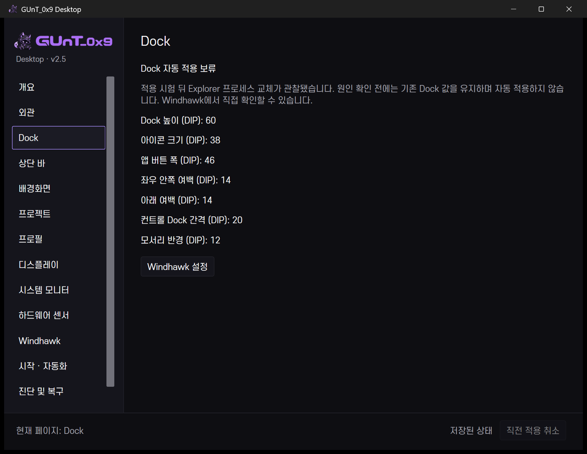
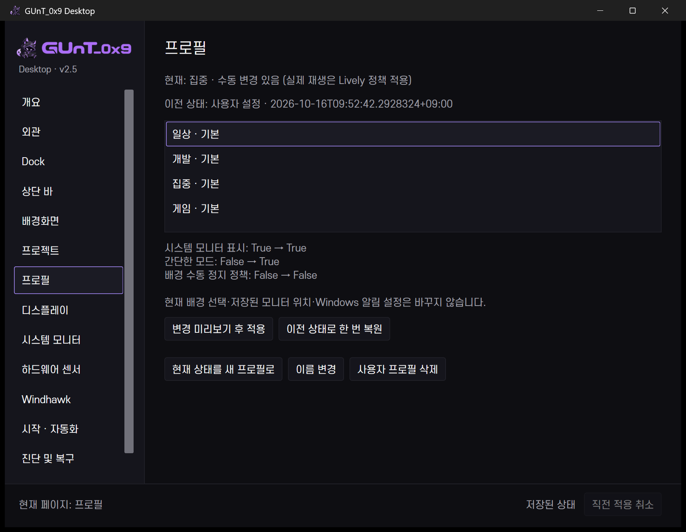
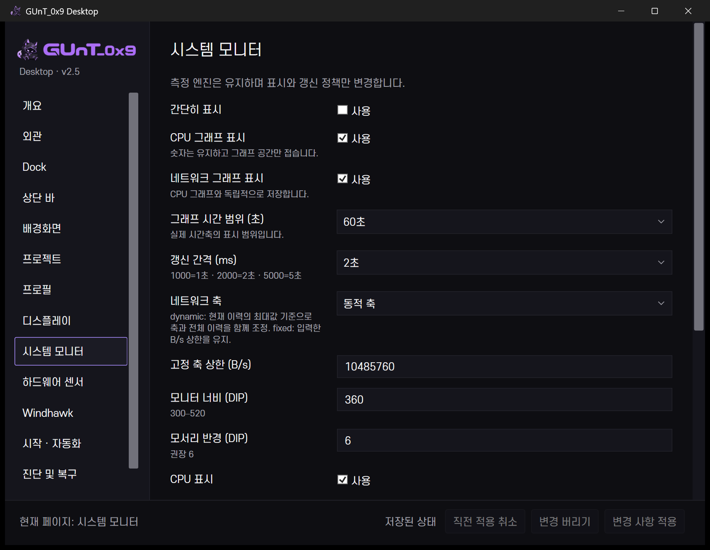
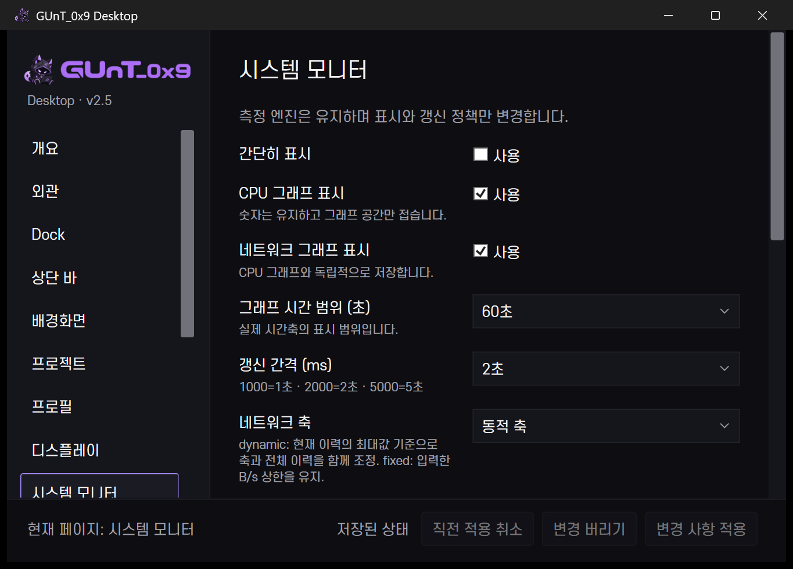
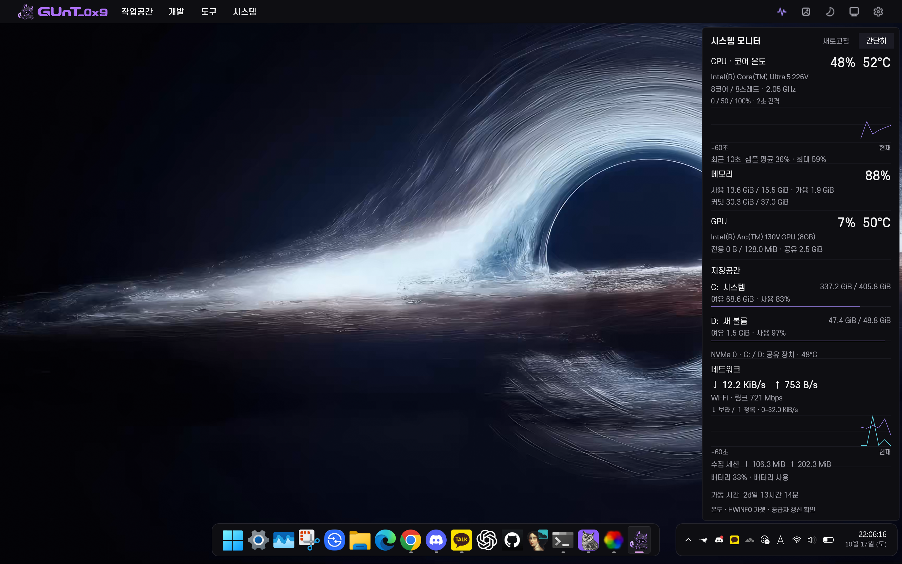

# v2.5 실제 검사 결과

2026-10-17, 기존 Windows 11 25H2 26200.9711 환경에서 수행했습니다. 구현·내보내기·실제 UI·성능·물리 다중 화면을 구분합니다. 개인 로그는 공개 저장소에 포함하지 않습니다.

## 통과

| 검사 | 실제 확인 | 근거 파일 |
|---|---|---|
| 분리 모델 44개 | dirty/정규화/버리기/Apply/Undo/CAS/실패 키 복구/범위/프로젝트/갤러리/스냅샷/사용자 프로필/Dock 안전 보류 | logs/v25-model-tests.json |
| 실제 UI 18개 | Dock 독립 페이지·보류, monitor 편집, 이동 취소·버리기, Projects 목적지, 11개 페이지, 배경 배치 보존, 실제 상태 행 | logs/v25-ui-verification.json |
| 실제 그래프 Apply/Undo | CPU 그래프 체크박스→JSON→Rainmeter 변수→원복, 저장 위치 유지 | logs/v25-live-apply.json |
| 프로젝트 GUI | 실재 폴더로 추가→Explorer 폴더 열기→이름 변경→삭제, QA 기록 제거 | logs/v25-project-ui.json |
| 기본 프로필 | Developer/Daily/Gaming/Focus 실제 세 관리 값 일치, 배경·저장 위치 보존, 1회 복원 및 재복원 거부, 시험 전 상태 복원 | logs/v25-live-profiles.json |
| 센서 연결 | 실제 CPU 온도·장치·단위·신선도 확인, 연결 저장→Undo→기존 매핑 복원 | logs/v25-sensor-ui.json |
| 갤러리 | 실제 16개 로컬 패키지·stable display ID 연결, 즐겨찾기 토글·원복, 현재 동일 패키지 1대 재적용·배치 확인 | logs/v25-gallery-discovery.json, v25-gallery-live.json |
| 키보드·창 | Ctrl+K 검색, Up/Down·Enter Dock 이동·Escape, 닫기 취소 후 값 보존, 780×560 DIP/175% 하단 적용 버튼 표시 | logs/v25-keyboard.json |
| 기존 기능 회귀 | PowerShell 파싱, Rainmeter 섹션 중복, 글꼴 SHA256, 설정 스키마, Bar/Rainmeter 각 1개, 기존 트랜잭션·센서 오류 검사 | logs/v24-verification.json |
| 기존 상단 바 | 실제 한국어 메뉴, 모니터 클릭 전환·원복 | logs/v24-topbar-verification.json 및 topbar 메뉴 검사 |
| 로고 | 두 실행 파일 16/24/32/48/64/128/256 아이콘 원본 SHA256, 창 아이콘, 제목·탐색 로고·About, 단일 인스턴스 | logs/branding-verification.json |
| 백업 | 최초 449개·중간 461개 모든 파일 SHA256 재읽기 일치 | logs/v25-backup-integrity.json |
| 코드 복구 사전 검사 | ControlCenter/TopBar/All 원본·현재 해시, 추가 partial 소스 이동 계획 | logs/v25-rollback-preflight.json |

## 미해결·보류

**Dock 자동 적용을 안정성 통과로 판단하지 않습니다.** 모서리 12→10→12의 실제 JSON·Windhawk INI·즉시 PID 검사에는 통과했지만, 종료 약 29초 후(22:02:19) Explorer PID가 교체됐습니다. 재시작 명령은 실행하지 않았고 해당 시각 Windows 응용 프로그램 로그의 Explorer 1000/1001/1002 이벤트는 없었습니다. 사용자는 현상을 확인하지 못했다고 응답했습니다. 원인은 미확정입니다.

실제 스타일·크기·라이브러리는 시험 전과 같고 SettingsChangeTime만 다릅니다. 현재 Dock은 원래 설정으로 동작하며 `state/dock-live-apply-hold.json`으로 CC와 서비스의 추가 자동 적용을 막았습니다. 이것은 성공으로 숨기지 않은 **안전 보류**입니다. 보류 이후 후속 검사와 성능 표본에서는 새 Explorer PID가 유지됐습니다. 장시간 안정성을 보증하지 않습니다.

## 부분 검증·미시험

- IDE·터미널·GitHub·직접 명령은 경로·인수·EncodedCommand 모델 검사만 수행. 실제 각 앱 내부 작업 완료는 미시험.
- 배경은 현재와 **같은 패키지**만 재적용. 다른 배경/전체 모니터/실제 실패 복구는 미시험.
- 센서 안내는 한 화면의 단계 안내이며 관리자 공급자 설정을 자동 완료하는 마법사는 아님. CPU 패키지 전력은 현재 값이 없어 사용 불가로 표시.
- 스냅샷 복원은 분리 실제 JSON 파일과 Undo 검사. 라이브 전체 코드 롤백은 실행하지 않음.
- 마지막에는 1대 연결. 과거 3대 기록과 저장 배치는 유지하되 실제 3대 재연결, 100%/150% 화면은 미시험.
- 실제 재로그인/재부팅, 배터리 지속시간·GPU 전력, 앱 종료 후 재로그인까지 프로필 자동 복원은 미시험.
- 조건 자동 프로필·새 화면 프로필 관리·첫 실행 마법사는 미구현.

## 성능 표본

8개 논리 프로세서 기준, CPU 누적 시간 차이를 전체 시스템 백분율로 나눴습니다. 각 약 31초 동안 2초 간격 메모리 평균입니다. 실제 작업 중 한 번의 표본으로 기존 v2.4와 동일 조건 비교나 절감률을 주장하지 않습니다. AC가 아닌 배터리 환경이며 다른 앱 부하가 있었습니다.

| 상태 | CC CPU | 평균 작업 집합 | 평균 private memory |
|---|---:|---:|---:|
| 개요 표시·3초 상태 갱신 | 0.288% | 138.5 MiB | 118.5 MiB |
| 갤러리 표시·영상 디코딩 없음 | 0.006% | 146.6 MiB | 125.0 MiB |

- 새 프로세스 시작부터 실제 Rainmeter 상태 행 접근까지 **1,058ms**, 1회 표본.
- 설치 배경 16개 메타데이터 검색 **105ms**, 초기 1회 표본. 디스크 캐시·파일 수에 따라 달라집니다.
- 창 정상 종료 후 Control Center 프로세스 **0개**. 신규 상주 서비스 없음.
- 동일 표본에서 상단 바 CPU 0.205–0.229%, Rainmeter 0.077–0.089%. Explorer 0.690–1.039%, HWiNFO 0.605–0.780%, Lively/mpv 등은 별도 프로세스로 측정했고 CC 부하에 합산하지 않았습니다.
- 프로젝트 폴더 창은 제한된 대기로 실제 열림을 확인했지만 지연 시간 계측을 하지 않아 수치를 제시하지 않습니다. GPU·배터리 소모량 미측정.

근거: logs/v25-startup-performance.json, logs/v24-performance-v25-overview-idle.json, logs/v24-performance-v25-gallery-idle.json, logs/v25-closed-performance.json.

## 재검사

제어 센터·Windows를 조작하는 실제 UI 검사는 사용 중 작업을 정리한 뒤 **하나씩** 실행합니다. 분리 모델 검사는 개인 설정·배경을 바꾸지 않습니다.

```powershell
.\scripts\verify-v25-models.ps1
.\scripts\verify-v25-ui.ps1
.\scripts\verify-v25-keyboard.ps1
.\scripts\verify-v25-apply.ps1
.\scripts\verify-v25-projects.ps1
.\scripts\verify-v25-profiles.ps1
.\scripts\verify-v25-sensors.ps1
.\scripts\verify-v24.ps1
```

`verify-v25-dock.ps1`은 안전 보류 파일이 있으면 실행하지 않습니다. 강제로 보류를 지우고 시험하지 마세요. 화면별 결과를 다른 Windows 빌드 전체의 호환성으로 일반화하지 않습니다.

## 실제 화면

창 단독 PrintWindow 캡처를 사용했습니다. 다른 앱이 겹친 CopyFromScreen 캡처는 문서에 넣지 않았습니다. 외부 공급자 장치 일련번호와 개인 경로를 공개 이미지에 포함하지 않았습니다.












## 개발 중 발견해 수정한 문제

- 프로필 연속 적용에서 layout.json 읽기 경합: 전체 레이아웃 캡처 제거·공유 읽기·최소 상태로 수정 후 네 프로필 재검사 통과.
- 두 번째 설정 DLL 빌드에서 이전 DLL이 사용 중: 고유한 버전 백업 경로로 수정.
- 선택 상자에 `[내부 키, 표시 이름]`이 보임: 표시 전용 선택 모델로 고치고 실제 화면에서 ‘60초/2초/동적 축/자동’ 확인.
- 빈 프로젝트 목록에서 실행 버튼이 처음 활성으로 표시됨: 최초 목록 로딩 후 가용성 계산·빈 목록 안내·높이 축소로 수정.
- 마지막 상단 바 빌드 직후 회귀 검사에서 Bar 0개: 빌드가 기존 Bar를 닫는 기존 동작 때문. 새 실행 파일을 시작하고 중복 없이 1개·응답·메뉴를 재확인했습니다.
- UIA 이름 중복·창 준비 대기 때문에 난 자동화 탐지 오류는 ControlType 조건·bounded 대기로 수정했습니다. 실제 기능 오류와 구분했습니다.

`kill-ai-slop` 설치 지침은 WPF 수동 검수의 참고로 사용했고, 웹용 탐지 결과를 WPF 검증으로 대신하지 않았습니다. 새 스킬·상주 서비스·UI 프레임워크는 설치하지 않았습니다.
