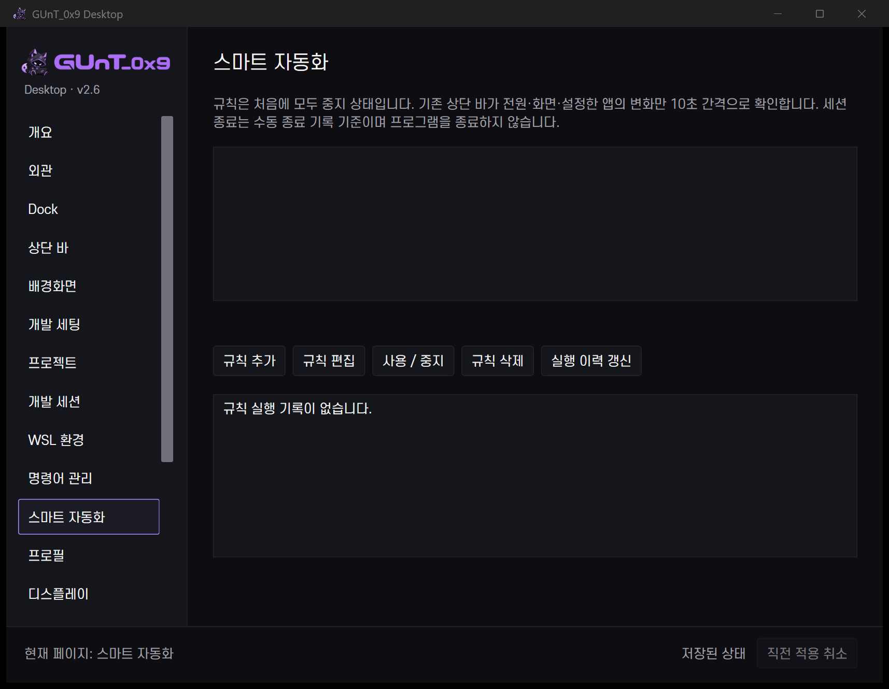

# v2.6 스마트 자동화

## 기본값과 감지

새 규칙은 **중지**입니다. 목록의 **사용/중지**에서 실제 조건·동작을 확인한 뒤 켭니다. 프로그램 설치·Windows 전원 계획·드라이버·보안 기능을 변경하지 않습니다.

| 조건 | 감지 방법 |
|---|---|
| 개발 세션 시작 | 기존 세션 서비스의 시작 이벤트 |
| 개발 세션 종료 기록 | 사용자가 세션 종료 기록 버튼을 누른 시점 |
| 설정한 앱 실행 | 기존 상단 바가 10초 간격으로 해당 프로세스 이름만 확인. 실행 상태로 바뀔 때 |
| AC 연결 / 배터리 전환 | Windows PowerStatus의 상태 변화 |
| 화면 구성 변경 | 연결 화면·위치·해상도·배율의 관측 변화 |

앱 이름의 `.exe`는 선택적으로 쓸 수 있으며 `Flow.Launcher` 같은 이름 안의 점은 제거하지 않습니다. 최초 전원·화면 관측만으로 자동 변경하지 않으며 이후 변화에 반응합니다. 앱 조건은 이미 실행 중인 앱도 규칙 사용 후 첫 관측에서 감지할 수 있습니다. 10초보다 짧게 켜졌다 꺼지는 앱은 놓칠 수 있습니다.

사용한 규칙이 없으면 새 worker를 시작하지 않습니다. 상단 바의 기존 타이머에서 값 변화만 확인하고, 실제 이벤트에서 같은 제어 센터 실행 파일을 **창 없이 한 번 실행한 뒤 종료**합니다. 새 상주 서비스·PowerShell 고빈도 polling daemon은 만들지 않았습니다.

## 동작과 제한

- 프로필 적용, 이전 자동화 소유 상태 복원.
- 모니터 표시/숨김, 배경 재생/일시정지.
- 등록한 프로젝트 폴더 열기, 자동화를 명시 허용한 개발 세션 시작.
- 우선순위 0–100, cooldown 10–86400초, 전원 추가 조건, 제외 앱 목록, 마지막 실행 시각·최근 100개 결과.
- 세션 이벤트에서 세션을 다시 시작하는 규칙은 거부합니다. 자동화 세션은 프로젝트 명령을 실행하지 않습니다.
- Lively의 배터리·전체화면 정책을 대체하지 않습니다. 기본 전원 규칙을 자동 추가하지 않습니다.
- 실제 세션·프로그램 종료를 감지해 강제 복원하는 기능은 아닙니다. 전체화면 감지는 미구현이며 해당 UI를 제공하지 않습니다.

## 소유 상태 복원

가장 최근 자동화 변경 직전의 모니터 표시·compact·수동 배경 정책을 저장합니다. 현재 값, 적용된 프로필 기록, 수동 배경 제어 기록이 자동화 이후의 예상 상태와 같을 때만 되돌립니다. 이후 수동 변경을 발견하면 복원하지 않습니다. 배경 패키지·모니터 위치를 되돌리지 않습니다.

동시에 적용된 여러 규칙의 전체 스택을 재생하는 기능은 아니며 최신 소유 스냅샷 한 단계입니다. 복원 기록은 한 번 소비합니다. Windows 밖에서 수행한 모든 같은 값의 수동 조작 의도를 완벽히 감지한다고 주장하지 않습니다.

[실제 조건·worker·복원 검사](v26-testing.md)
