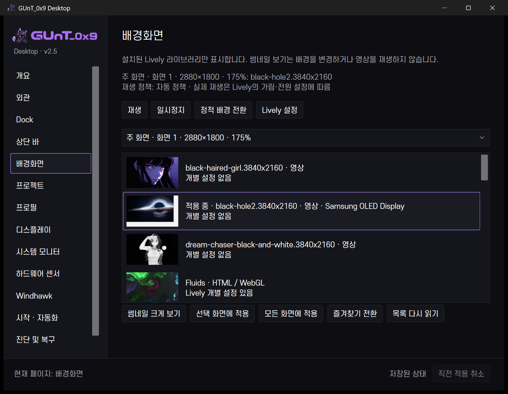
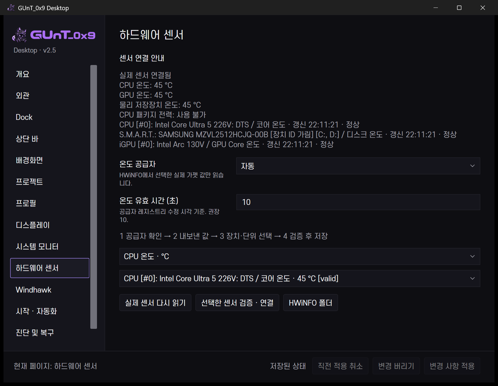
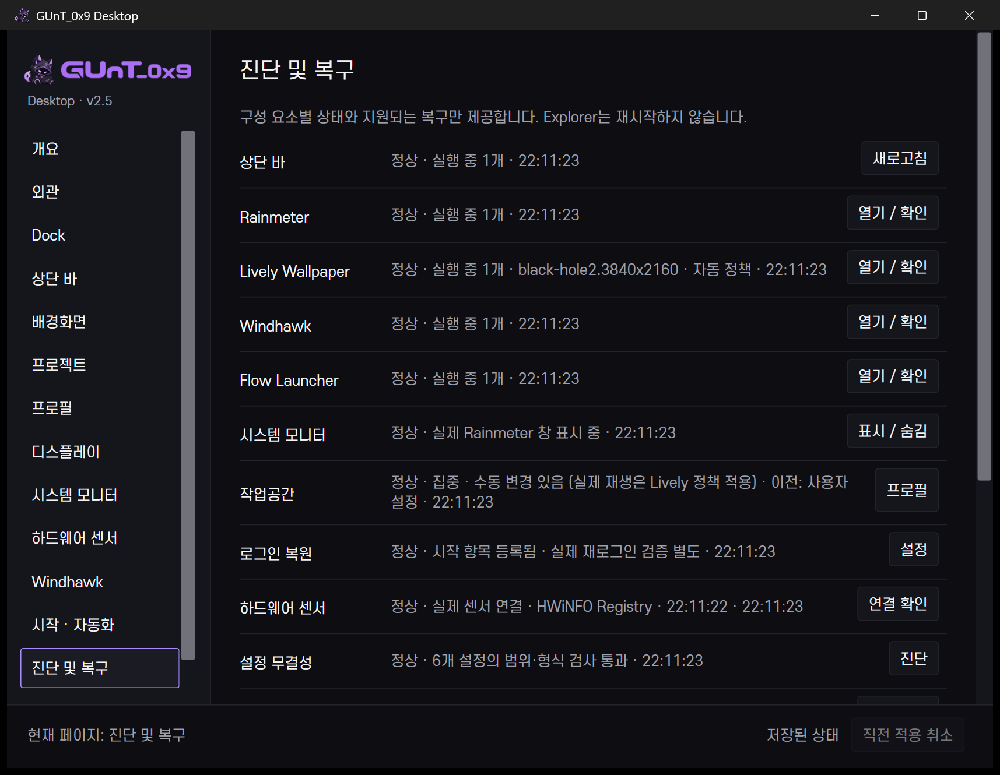

# v2.6 선행 통합 기능과 남은 범위

v2.5 실행 파일에 아래 생산성 기능을 함께 넣었습니다. 별도 v2.6 전체 완료를 의미하지 않습니다.

## 프로젝트

실제 개인 프로젝트 목록, 검색, 고정, 고정 그룹 안 순서, 최근 요청순, 폴더·VS Code·터미널·GitHub·명시적 명령. 누락 경로는 편집/경로 복구로 안내합니다. GUI에서 실제 추가→폴더 열기→편집→삭제를 확인했습니다. IDE·터미널·URL·명령은 모델에서 경로와 인수를 검사했고 실제 사용자 앱 내부 완료는 미검증입니다. 상단 바 작업공간 메뉴에도 고정한 실제 폴더를 열 때 읽어 표시합니다.

## Lively 갤러리

공식 로컬 `Settings.json`의 WallpaperDir 아래 `wallpapers`와 `SaveData/wptmp`의 `LivelyInfo.json`을 읽습니다. 설치된 16개 패키지를 발견했고 임의 항목·영상 다운로드는 하지 않았습니다. 공식 배치 파일의 stable display ID로 현재 화면과 선택을 표시합니다.

보이는 목록의 썸네일만 최대 240px로 디코딩합니다. 영상 미리보기는 새 플레이어를 만들지 않고 **썸네일 크게 보기**로 명확히 구분합니다. 실제 즐겨찾기 토글·원복과 현재 패키지 1대 재적용을 검사했습니다. 다른 배경/모든 화면 전환과 실패 복구는 추가 실제 검증이 필요합니다. 확인 전 현재 배경을 바꾸지 않도록 적용 요약을 표시합니다.

사용자가 Lively에서 배경을 바꾸면 배치 파일 watcher와 350ms debounce로 갤러리를 갱신합니다. 새 polling daemon은 없습니다. Lively의 배터리·전체화면 중지 정책을 그대로 사용합니다. GUNT는 수동 중지 요청을 기록하지만 자동 정책으로 정지한 것을 재생 중이라 표시하지 않습니다.

## 센서·복구

기존 `GuntHwinfoTelemetry` 엔진을 재사용합니다. 실제 보고 값·장치 정체성·섭씨/와트 단위·최근 갱신을 확인한 매핑만 기존 트랜잭션으로 저장합니다. CPU 연결 저장→Undo→원래 매핑 복원을 실제 검사했습니다. 없는 HWiNFO를 설치하거나 관리자 창을 자동 조작하지 않습니다.

진단은 실제 프로세스/시작 등록/설정/화면을 읽고 지원 복구만 제공합니다. 선택한 JSON 스냅샷 하나의 실제 차이를 확인한 뒤 기존 Apply/Undo로 복원합니다. 다른 구성 요소 전체 초기화와 Explorer 재시작은 하지 않습니다.

## 선택적 자동화

조건 기반 자동 프로필 전환, 별도 저장 화면 프로필 관리자, 첫 실행 마법사는 미구현입니다. 불안정한 API를 추측하거나 Lively의 전원·전체화면 제어와 경쟁하는 상주 감시기를 만들지 않았습니다. 향후 필요하면 비활성 기본값·우선순위·cooldown·직전 상태 복원·실행 이유 기록을 함께 설계해야 합니다. 현재 제공하는 명령 찾기는 Control Center 내부 전용이며 범용 앱 검색과 Flow Launcher를 대체하지 않습니다.
