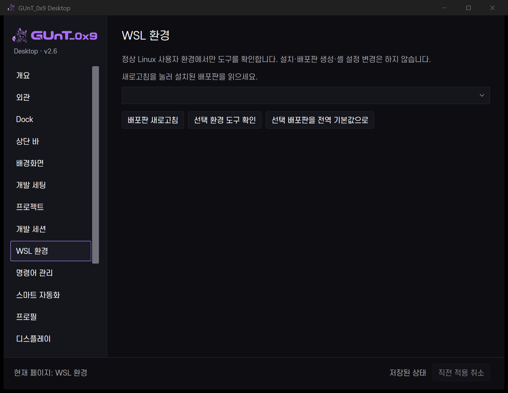
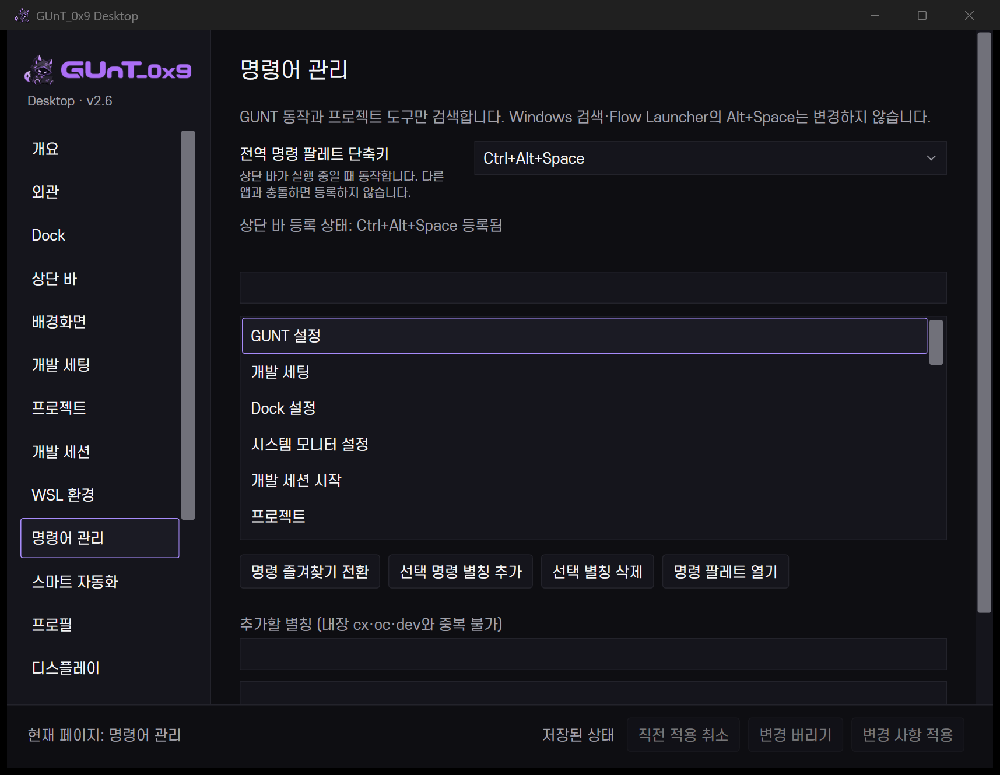

# v2.6 실제 검사와 제한

검사는 2026-10-17 구현 중 수행했고 10월 19일 이어서 화면 연결·자동화·복구를 확인했습니다. 공개 저장소에는 시험 코드와 개인정보가 없는 실제 창 캡처만 포함합니다. `logs/`, `state/`, `tests/`의 실행 자료는 로컬에 남습니다. 모형 검사를 실제 터미널 실행으로 대신 표시하지 않습니다.

## 통과

| 범위 | 실제 근거 |
|---|---|
| .NET Framework 4.8 빌드 | 공용 설정 DLL·WinForms 상단 바·WPF 제어 센터 빌드. 새 소스가 기존 빌드에 포함됨 |
| v2.6 모델 | `verify-v26-models.ps1`: 59개. 파일 탐색·경로/인수·Git NUL 파싱·설정 충돌·세션/명령/자동화·구형 프로젝트 읽기·수동 변경 보호 |
| v2.5 회귀 | `verify-v25-models.ps1`: 44개. 기존 설정·프로젝트·프로필·갤러리·복구 모델 |
| 개발 UI | 실제 루트 등록 → 다시 탐색 버튼 → 한글 자식 폴더 선택 → 기존 프로젝트 DB·현재 선택 저장. QA 등록 해제, 폴더 삭제 안 함 |
| 신규 페이지 | 개발 세팅·세션·WSL·명령·자동화의 실제 UI 요소, 빠른 패널, 전역 팔레트: 7개 그룹 |
| 키보드·작은 창 | Ctrl+K·fuzzy 검색·방향키·Enter Dock 목적지·Escape, 미저장 닫기 계속 편집, 780×560 DIP / 175% 적용 영역 |
| 대화형 Codex | Windows Terminal 및 CMD에서 WSL 일반 계정 프로세스·실제 `/proc` cwd·독립 터미널 확인 |
| 대화형 OpenCode | Windows Terminal에서 같은 검사. 한글·공백·괄호·따옴표·`& $ ; %` 폴더 사용 |
| VS Code + Codex 세션 | 정확한 폴더의 새 VS Code 창과 독립 Codex 터미널, 개별 결과, 중복 시작 차단, 재시작 구성 저장, 종료 기록 |
| 실제 UI 연결 | 개발 세션 버튼 → 대상 경로/VS Code 요약 → 취소, 상단 바 브랜드 메뉴 → 빠른 패널 열기 |
| 빠른 패널 실제 동작 | 현재 프로젝트 유지·실제 Git 분기 조회·모니터 두 번 전환·원래 표시 상태 복원 |
| 복구 사전 검사 | `rollback-v26-developer.ps1 -Component All -WhatIf`: 현재·백업 해시 26개 확인. 실제 전체 복구는 미실행 |
| WSL 환경 | 실제 배포판 열거·일반 계정·설치 도구 버전 확인. root·도구 없음·접근 실패는 오류로 차단 |
| 자동화 서비스 | 중지 규칙 무효·명시 사용 규칙의 실제 위젯 숨김·한 단계 복원·선택 배경 유지 |
| 자동화 실제 연결 | 기존 상단 바가 검증 앱 실행을 감지 → 무창 이벤트 worker → 실제 위젯 숨김 → 소유 상태 복원. QA 규칙 제거, 새 daemon 없음 |

명령/세션의 “요청 전달”은 각 프로그램의 실행 요청까지입니다. CLI 프롬프트를 제출하거나 대화·소스·명령 내용을 저장하지 않았습니다. 재시작 구성은 프로젝트·도구·환경을 다시 여는 것이며 AI 대화 복원이 아닙니다.

## 해결한 검사 중 문제

- WSL UTF-16 목록, Linux UTF-8, 과도한 Windows 인수 따옴표와 Windows Terminal의 세미콜론 구문 경계를 실제 환경에서 수정했습니다.
- Git GUI 대신 실제 `git.exe` 선택, dot가 포함된 앱 이름 유지, 종료 직후 연속 세션의 중복 방지, 프로젝트 SchemaVersion 2 보호를 추가했습니다.
- 빠른 패널의 작업 중 연속 클릭은 버튼 사용 상태와 완료 피드백으로 명확히 처리합니다. UI 시험은 위젯 변경과 작업 완료를 구분해 기다립니다.

## 실행 방법

```powershell
.\scripts\build-configuration.ps1
.\scripts\build-control-center.ps1
.\scripts\verify-v26-models.ps1
.\scripts\verify-v25-models.ps1
.\scripts\verify-v26-ui.ps1
.\scripts\verify-v26-developer-ui.ps1
.\scripts\verify-v26-integration.ps1
.\scripts\verify-v26-live-cli.ps1 -Distribution '<설치된 배포판>'
.\scripts\verify-v26-session-live.ps1 -Distribution '<설치된 배포판>'
.\scripts\verify-v26-automation-live.ps1
.\scripts\verify-v26-automation-worker.ps1
```

UI/실행 시험은 Windows 대화형 로그인 환경에서 **순서대로** 수행합니다. 실제 터미널·편집기·위젯을 열고 검사 전 상태로 돌립니다. CLI 시험에는 도구 설치와 정상 사용자, Windows Terminal이 필요하며 없으면 실패 사유를 확인합니다. QA 폴더는 로컬 `tests/`에 보존하고, 테스트가 소유한 창만 닫습니다. 개인 작업 중에 병렬 실행하지 마세요.

## 미검증·지원 제한

- 실제 세 모니터 재연결·음수 좌표·다른 물리 DPI(100/150%)·AC 케이블 전환·실제 로그인 재시작은 미검증. 현재 175% 화면 검증입니다.
- Remote WSL VS Code, 전체화면 자동화, AI 대화 복원, 세션 앱의 실제 종료 감지는 구현하지 않았습니다. 종료는 사용자의 종료 기록 버튼 기준입니다.
- 사용자 임의 프로젝트 명령·다른 편집기·GitHub URL의 모든 외부 앱 내부 동작은 시험하지 않았습니다. 새 명령 자동 실행은 없습니다.
- Flow Launcher 플러그인은 설치하지 않았습니다. 기존 Flow 단축키를 보존한 GUNT 전용 팔레트입니다.
- Dock 실시간 적용 보류와 알려진 Explorer Styler 충돌 비활성은 유지합니다. 이번 결과로 Windows Shell 전체 안정성이 검증됐다고 주장하지 않습니다.

## 실제 화면






개인 폴더·설치 도구 목록을 공개하지 않도록 최초 빈 상태의 실제 화면을 사용했습니다. 실행 성공을 그려 넣은 예시 화면이 아닙니다.

## 성능 표본

2026-10-19 개발 세팅 화면을 열고 작업을 마친 뒤 20초 측정했습니다. CPU는 논리 프로세서 전체 기준, 메모리는 평균 Working Set입니다.

| 프로세스 | CPU | 메모리 |
|---|---:|---:|
| GUNT.ControlCenter | 0.000% (소수점 3자리 반올림) | 141.2 MiB |
| GUNT-Bar | 0.268% | 40.4 MiB |

두 프로세스 모두 응답 상태였습니다. 이 표본은 배터리 수명·GPU 전력 절감·장시간 안정성의 증거가 아닙니다. Explorer·Lively·HWiNFO 등의 사용량을 GUNT에 합산하지 않았습니다. 제어 센터 startup·프로젝트 launch 지연의 통제된 비교 표본은 미수집입니다. 빠른 패널을 닫은 뒤 제어 센터 1개와 기존 상단 바가 남았으며 별도 상주 서비스는 추가하지 않았습니다.
