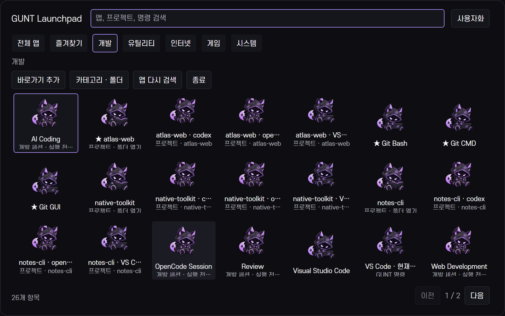

# GUNT Launchpad 개발 기록

## dev.4 — Launchpad Foundation

2026-10-20. dev.3 `048be04`의 이력을 보존한 `feat/v30-launchpad` 개발 프리뷰다. 정식 3.0 릴리스가 아니다.

### 구현

- 기존 WPF 앱의 `launchpad` 진입점. 한 창을 재사용하고 10분간 숨겨져 있으면 종료한다. 별도 키보드 데몬을 만들지 않는다. 상단 바가 전역 키를 소유한다.
- 시작 메뉴 `.lnk`와 Shell AppsFolder의 패키지 AUMID를 실행 없이 발견한다. 경로·인수·작업 폴더의 정확한 일치로만 바로가기를 중복 제거한다. 캐시는 24시간 뒤 또는 명시적 새로고침 때 갱신한다. 자동 등록 변경 감시는 아직 없다.
- 7열 기본값, 화면에 맞춘 페이지 단위 생성, 현재 페이지 아이콘만 비동기 추출, 최대 128개 캐시와 동시 작업 2개. 카테고리·폴더·별칭·즐겨찾기·사용자 순서를 저장한다.
- 드래그 임계값과 실행 클릭을 구분한다. 카테고리 드롭·앱 앞 삽입·폴더 드롭, 메뉴를 통한 동일 이동을 제공한다. 폴더 해제와 카테고리 삭제는 앱을 보존한다.
- HTTP(S), 절대 exe/lnk/폴더, 패키지 AUMID, 기존 프로젝트·명령을 공유 DesktopService에서 실행한다. exe 인수는 JSON 문자열 배열로 받아 기존 Windows 인수 인코더로 전달한다. 세션은 현재 프로젝트와 실행 미리보기를 확인한다. 사용자 명령 단계는 별도 동의 없이 건너뛴다.
- `config/launchpad.json`과 `state/launchpad-catalog.json`은 비공개다. 기존 버전 검사·백업·원자 저장·동시 편집 보호를 이용한다. 알 수 없는 스키마를 덮어쓰지 않는다.

### 검증

Windows Framework C# 5 후보 빌드와 `verify-launchpad.ps1`의 38개 검사를 통과했다. 별도 fixture에서 실제 키 등록 충돌, 설정 저장·충돌, 유효하지 않은 대상 거부, 1,000개 항목의 페이지 생성, 검색, 순서·폴더·즐겨찾기 저장, 포커스·숨김/재열기, 실제 앱 발견을 확인했다. 실행은 테스트 대역으로 가로채 다른 앱을 자동 실행하지 않았다.

사용자가 열어 둔 dev.3 창을 보존하기 위해 `build-control-center.ps1 -Candidate`로 독립 후보를 빌드했다. 실제 운영 상단 바 통합, 모든 등록 앱 실행, 실제 마우스 드래그, 다른 배율은 이 체크포인트에서 완료로 표시하지 않는다.

별도 문서용 루트에서 실제 등록 앱의 공개 가능한 부분 목록과 실제 Windows 실행 파일·공개 URL·예제 프로젝트를 사용해 WPF 화면을 캡처했다. 이미지 생성은 앱 화면 캡처에 사용하지 않는다. 마스코트 변형과 Settings/Workspace 분리는 다음 체크포인트에서 기록한다.

이 첫 화면의 반복 GUNT 아이콘·일부 잘린 보조 문구는 후속 다듬기 대상으로 남겼다. 실제 캡처의 결함을 이미지 편집으로 숨기지 않았다.

## dev.5 — Mascot Experience

포즈 10종(승인 코딩 원본 1종 + 개별 참조 생성 9종)을 실제로 제작·직접 검수했다. [자산과 생성 프롬프트](../assets/branding/mascot/README.md)에서 출처·투명 내보내기·중복 검사·크기별 결과를 구분한다. 원래 앱 아이콘이 기본이며 앱과 카테고리별 포즈를 선택할 수 있다. 없는 포즈 파일은 원래 아이콘을 유지한다.

WPF 90ms hover opacity·110ms 재열기 opacity만 사용하며 Windows ClientAreaAnimation과 사용자 설정을 따른다. 숨김 시 animation clock을 해제한다. 반복 프레임 루프·눈 깜빡임 프레임·하이브리드 배지는 구현하지 않았다.

Windows 후보 빌드·50개 검사를 통과했다. 10종 파일 존재와 실제 다른 해시, 사용자가 애니메이션을 끈 상태와 Windows 동작 줄이기 연동, 공통 앱 실행·정렬·저장 회귀를 포함한다. UI 화면과 그림 검수표는 서로 다른 증거다.

## dev.6 — Application Reorganization

기존 WPF 호스트에 Settings와 Workspace 탐색을 분리했다. `settings`는 기존 `overview`, `workspace`는 `workspace-overview`에 연결한다. 기존 v2.6의 19개 페이지 ID·저장 형식·프로젝트 서비스·CLI·세션 엔진은 유지한다. `backup`도 진단으로 연결한다. 공용 창 제목은 기존 IPC 호환을 위해 GUnT_0x9 Desktop을 유지하고 탐색 머리에 현재 영역을 표시한다.

- Settings: 개인 설정·프로필, 디스플레이·모니터·센서·Windhawk, Launchpad·단축키·시작/복원, 진단·정보.
- Workspace: 개요, 개발 세팅·프로젝트·세션·WSL, 자동화·명령 관리.
- Launchpad: 앱 실행·정리. 전체 앱에서 내부 설정 명령이 앱을 압도하지 않도록 Settings/Workspace 진입점만 기본 표시하고 나머지 GUNT 명령은 검색/시스템 카테고리에서 찾는다.

원래 CommandRegistry의 별칭·프로젝트별 명령을 함께 검색한다. 개발 데이터가 바뀌면 다음 열기에 목록을 갱신하고 변경된 문맥에서 오래된 실행 대상을 바로 실행하지 않는다. 기존 Quick Panel과 명령 팔레트에도 영역 진입점을 연결했다. 기존 WinForms 상단 바가 유일한 전역 키 등록 호스트다.

### 실제 검토로 바꾼 부분

초기 dev.4 화면은 관리 버튼 줄과 반복 카테고리 제목으로 그리드 공간이 줄었고, 보조 문구가 잘렸으며 높이가 다른 항목의 아이콘이 어긋났다. 관리 동작을 메뉴로 모으고 폴더/검색 때만 경로를 표시하며 이름·문맥 행 높이를 맞췄다. 원래 아이콘 추출은 Shell image factory를 우선하고 실패 시 Windows 기본 아이콘을 사용한다. 마스코트 테마에서도 미지정 앱은 원래 아이콘이며 카테고리 포즈는 탐색 아이콘에만 적용한다. 항목 표시 편집에서 원래 앱 아이콘으로 되돌릴 수 있다. 설치 앱의 아이콘 실패를 GUNT 마스코트로 대신해 앱 정체성을 흐리지 않는다.

재열기에서는 같은 설정 리비전·페이지·카탈로그이면 컨트롤을 유지한다. 아이콘 대기는 비동기 semaphore를 이용하고 이전 검색의 대기 작업을 취소한다. 파일/프로세스 핸들은 소유 범위에서 해제한다. 장식용 카드·배경 그라디언트·새 배경 서비스는 추가하지 않았다.

### 호환성과 남은 범위

- 시작 메뉴·HKCU/HKLM 32/64비트 App Paths·패키지 AppsFolder를 읽는다. 패키지는 캐시 등록과 Shell 파싱으로 확인한 AUMID를 Explorer에 전달한다. 모든 Windows 앱/브라우저/기업 등록 형식의 실제 실행을 검증한 것은 아니다.
- 등록 변화의 상시 감시는 없다. 명시적 다시 검색과 다음 프로세스의 24시간 캐시 확인을 이용한다.
- 한 운영 루트를 기준으로 검증했다. 여러 휴대형 설치 루트의 동시 UI 호스트 운용은 검증하지 않았다.
- 100/125/200% 물리 검증, 고대비·스크린리더 전체 검증, 장시간 아이콘 공급자/메모리 추세는 남아 있다.
- 그림 10종은 실제 다른 포즈이며 새 파생 그림의 추가 사용자 승인·프레임 애니메이션·하이브리드 배지는 별도다.

[최종 검증·성능·화면 결과](v30-launchpad-report.md)에 최종 상태를 기록한다.

## 사용 흐름

- 기존 상단 바를 실행하고 `Ctrl+Alt+L`을 누른다. 설정 → 단축키 또는 Launchpad 관리 → 사용자화에서 키를 기록·검증·저장한다. 충돌하면 등록 불가 메시지를 표시하며 다른 앱의 키를 빼앗지 않는다.
- 앱을 한 번 클릭하거나 화살표·Enter로 실행을 요청한다. Escape는 검색 지우기 → 폴더 뒤로 → 닫기의 순서다. 바깥 클릭은 메뉴/편집/실행 요청 중이 아닐 때 닫는다.
- 오른쪽 클릭으로 즐겨찾기·이동·순서·이름/별칭/포즈·숨기기를 바꾼다. 앱을 드래그하면 다른 앱 앞, 카테고리, 폴더로 이동한다. 드래그 대신 같은 메뉴를 이용할 수 있다. 폴더 안에서 이동 메뉴로 폴더 밖 카테고리를 선택한다.
- 관리 메뉴에서 카테고리/폴더/바로가기를 만들고, 카테고리/폴더의 오른쪽 메뉴로 이름·순서·삭제를 조정한다. 삭제는 앱을 제거하지 않는다. 사용자 바로가기는 exe·lnk·폴더·HTTP(S)이며 exe 인수는 JSON 문자열 배열이다. 명령줄 셸 문법으로 해석하지 않는다.
- 사용자화에서 원래 아이콘/마스코트 테마, 48–80 DIP 아이콘, 최대열수·기본 카테고리·화면·실행 후 닫기·애니메이션·투명도를 고른다. 투명도는 선택 시 재열기/프로세스 재시작 안내에 따른다. 기본은 불투명이다. 새 프레임 그림 없이 짧은 opacity 전환만 사용한다.
- 개발 세션은 현재 선택 프로젝트와 기존 실행 요약을 확인한다. 프로젝트 변경은 Workspace의 기존 프로젝트 데이터에만 저장하며 Launchpad용 두 번째 DB를 만들지 않는다.

단축키 전체 갱신·충돌 시험은 `verify-launchpad-hotkey-reload.ps1`, 실제 입력 시험은 `verify-launchpad-desktop.ps1`이며 다른 GUI 시험/캡처와 동시에 실행하지 않는다. 키 갱신 시험은 원본 설정을 저장하고 자신의 마지막 변경과 일치할 때만 정확히 복원한다. 불필요한 전역 키 시험을 평상시 실행하지 않는다.
