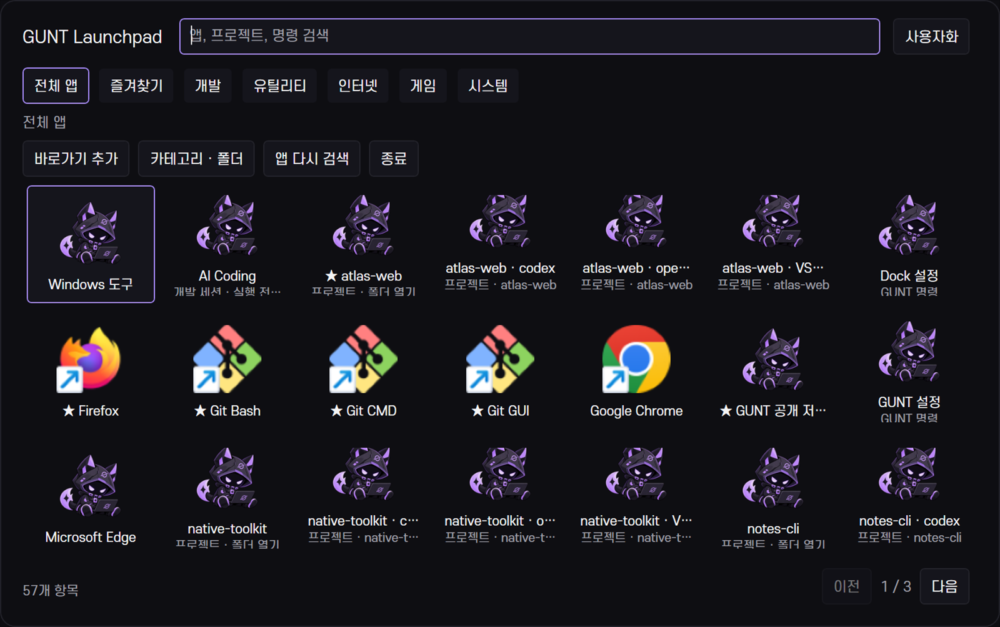

# GUNT Launchpad 개발 기록

## dev.4 — Launchpad Foundation

2026-10-20. dev.3 `048be04`의 이력을 보존한 `feat/v30-launchpad` 개발 프리뷰다. 정식 3.0 릴리스가 아니다.

### 구현

- 기존 WPF 앱의 `launchpad` 진입점. 한 창을 재사용하고 10분간 숨겨져 있으면 종료한다. 별도 키보드 데몬을 만들지 않는다. 상단 바가 전역 키를 소유한다.
- 시작 메뉴 `.lnk`와 Shell AppsFolder의 패키지 AUMID를 실행 없이 발견한다. 경로·인수·작업 폴더의 정확한 일치로만 바로가기를 중복 제거한다. 캐시는 24시간 뒤 또는 명시적 새로고침 때 갱신한다. 자동 등록 변경 감시는 아직 없다.
- 7열 기본값, 화면에 맞춘 페이지 단위 생성, 현재 페이지 아이콘만 비동기 추출, 최대 128개 캐시와 동시 작업 2개. 카테고리·폴더·별칭·즐겨찾기·사용자 순서를 저장한다.
- 드래그 임계값과 실행 클릭을 구분한다. 카테고리 드롭·앱 앞 삽입·폴더 드롭, 메뉴를 통한 동일 이동을 제공한다. 폴더 해제와 카테고리 삭제는 앱을 보존한다.
- HTTP(S), 절대 exe/lnk/폴더, 패키지 AUMID, 기존 프로젝트·명령을 공유 DesktopService에서 실행한다. exe 인수는 JSON 문자열 배열로 받아 기존 Windows 인수 인코더로 전달한다. 세션은 현재 프로젝트와 실행 미리보기를 확인한다. 사용자 명령 단계는 별도 동의 없이 건너뛴다.
- `config/launchpad.json`과 `state/launchpad-catalog.json`은 비공개다. 기존 버전 검사·백업·원자 저장·동시 편집 보호를 이용한다. 알 수 없는 스키마를 덮어쓰지 않는다.

### 검증

Windows Framework C# 5 후보 빌드와 `verify-launchpad.ps1`의 38개 검사를 통과했다. 별도 fixture에서 실제 키 등록 충돌, 설정 저장·충돌, 유효하지 않은 대상 거부, 1,000개 항목의 페이지 생성, 검색, 순서·폴더·즐겨찾기 저장, 포커스·숨김/재열기, 실제 앱 발견을 확인했다. 실행은 테스트 대역으로 가로채 다른 앱을 자동 실행하지 않았다.

사용자가 열어 둔 dev.3 창을 보존하기 위해 `build-control-center.ps1 -Candidate`로 독립 후보를 빌드했다. 실제 운영 상단 바 통합, 모든 등록 앱 실행, 실제 마우스 드래그, 다른 배율은 이 체크포인트에서 완료로 표시하지 않는다.

별도 문서용 루트에서 실제 등록 앱의 공개 가능한 부분 목록과 실제 Windows 실행 파일·공개 URL·예제 프로젝트를 사용해 WPF 화면을 캡처했다. 이미지 생성은 앱 화면 캡처에 사용하지 않는다. 마스코트 변형과 Settings/Workspace 분리는 다음 체크포인트에서 기록한다.

이 첫 화면의 반복 GUNT 아이콘·일부 잘린 보조 문구는 후속 다듬기 대상으로 남겼다. 실제 캡처의 결함을 이미지 편집으로 숨기지 않았다.
