# GUnT_0x9 Desktop — 버전별 시각 기록

README에는 현재 제품과 대표 화면을 먼저 소개하고, 이 문서에 변화 과정과 전후 비교를 모읍니다. 이미지는 실제 Windows 앱에서 얻었으며 디자인 목업을 사용하지 않았습니다. 기존 공개 이미지는 안정적인 경로를 유지하고 중복 저장하지 않습니다.

## v2.4 — Desktop Foundation

변경 기록 날짜는 **2026-10-16**입니다. 한국어 상단 바·브랜딩, 실제 시간축 그래프·센서, 모니터/DPI 배치와 WPF 설정·복구 기반을 정리했습니다.

이 이미지는 v2.5 작업 전에 보존한 **v2.4 UI**이며 파일 이름은 기존 링크 때문에 유지합니다. 화면에 표시된 캡처 시점은 10월 17일입니다. 최근 UI 또는 현재 센서 상태를 뜻하지 않습니다. 사용자 배경이 포함된 과거 데스크톱 원본은 새 공개 쇼케이스에 재사용하지 않습니다.

[당시 보고](v24-report.md) · [검증](v24-testing.md) · [추가 수정](v24-flicker-mods-report.md) · [복구](v24-recovery.md)

## v2.5 — UX Overhaul

**2026-10-17.** 실제 상태 행·14개 목적지, 프로젝트 관리·Lively 갤러리, 프로필 미리보기와 미저장 설정 보호·복원을 정리했습니다. Dock 적용 보류는 당시 제한이며 현재도 유지됩니다.

| 개요 | 프로젝트 관리 |
|---|---|
|  |  |

개인 프로젝트가 없는 실제 초기 상태입니다. 갤러리 기능은 당시 구현됐지만 로컬 배경 썸네일의 재배포 권한을 확인할 수 없어 이번 쇼케이스에 해당 이미지를 추가하지 않았습니다.

[UI 보고·v2.4 전후 비교](v25-ux-overhaul.md) · [검증](v25-testing.md) · [복구](v25-recovery.md)

## v2.6 — Developer Workspace

**2026-10-17–19 개발·검증 기록.** 프로젝트 루트 탐색·기본값 상속, WSL Codex/OpenCode, 세션·명령 팔레트·빠른 패널, 기본 중지 자동화를 통합했습니다. 외부 프로그램의 준비 완료와 실행 요청은 구분합니다.

| 개발 세팅 | 개발 세션 |
|---|---|
|  |  |

### 빠른 동작

| v2.6 명령 팔레트 | v2.6 빠른 패널 |
|---|---|
|  |  |

기존 공개 이미지를 그대로 참조했습니다. 실행 성공 화면을 그려 넣거나 개인 프로젝트를 보이게 하지 않았습니다. [전체 기존 화면·검증](v26-testing.md), [사용법](v26-developer-workspace.md), [세션](v26-development-sessions.md), [복구](v26-recovery.md)를 참고하세요.

## v3.0.0-dev.1 → v3.0.0-dev.2 비교

두 버전의 개발 기록 날짜는 **2026-10-19**입니다. dev.1은 공통 리소스·목적별 탐색·적응형 배치의 기반을 마련했고, dev.2는 프로젝트 행·본문 세션 편집·가상화 그리드를 보완했습니다.

다음 이미지는 **보존한 dev.1 빌드와 dev.2 빌드를 이번 문서 작업에서 다시 실행한 캡처**입니다. 각각 별도 문서용 설정과 같은 구조의 예제 프로젝트를 사용했으며 요청 창 크기는 1400×860 DIP, 실제 배율은 175%입니다. 당시 사용자 환경을 그대로 복원한 화면이나 성능 비교 자료로 해석하지 않습니다.

| dev.1 — 개발 세팅 | dev.2 — 개발 세팅 |
|---|---|
|  |  |

행 안에서 유형·Git 분기·수정/미추적 개수·즐겨찾기를 확인하고, 데이터 수에 따라 목록 높이를 줄였습니다. 보조 실행 도구는 접어 두고 기존 기능은 유지합니다. 예제 저장소는 실제 파일·Git 이력을 갖습니다. 최근 실행 기록은 만들지 않아 `사용 기록 없음`으로 보입니다.

| dev.1 — 세션 | dev.2 — 세션 |
|---|---|
|  |  |

단계 속성을 본문에서 펼쳐 편집하고 순서·사용 여부·제거를 한곳에 모았습니다. 실행 미리보기와 전체 이력을 구분합니다. WSL 미지정과 준비되지 않은 상태를 성공으로 바꾸지 않았으며 이 캡처에서는 세션·CLI를 실행하지 않았습니다.

### dev.2 빠른 도구

| 명령 팔레트 | 빠른 패널 |
|---|---|
|  |  |

별칭 검색과 프로젝트 문맥을 보여 줍니다. 팔레트의 하단 단축키 안내는 현재 고정 높이에서 스크롤 아래에 일부 놓입니다. 화면을 합성해 이 제한을 숨기지 않았습니다.

### 검증·공개 범위

- 이전 dev.2 구현 검증: 실제 Windows 주요 화면 10개, 175%·연결 화면 1개, WPF 검사 29개와 OS 키 입력·상단 바 통합 검사 15개. [원래 범위](v30-screenshots.md)
- 이번 문서 캡처: 검증된 Windows 실행 파일을 사용하고 `C:\GUNT-DocDemo\...` 안에만 예제 설정을 생성. 사용자의 설정·작업공간·현재 배경을 변경하지 않음.
- 공개 PNG는 창만 캡처한 원본에서 별도 RGB 내보내기·메타데이터 제거·읽기 가능한 크기로 축소한 파일. 픽셀 가림은 필요하지 않았으며 개인 폴더·장치 ID·타사 배경을 포함하지 않음.
- 새 갤러리의 실제 구현·개인 환경 검증은 [UI 보고](v30-ui-overhaul.md)에 기록. 개인 경로와 타사 배경 썸네일이 포함된 원본은 공개하지 않음.
- 새 캡처에서 성능을 다시 측정한 것은 아님. 기존 수치·증가한 비용·제외 범위는 [성능 보고](v30-performance.md)를 참조.

[공개 이미지 manifest](images/releases/manifest.json)는 파일 해시·출처·버전·검토 상태를 기록합니다. 원본 경로와 개인 실행 로그는 Git에서 제외합니다. 자동 검사는 육안 개인정보 검토를 대신하지 않습니다.

[디자인 시스템](v30-ui-design-system.md) · [dev.2 구현](v30-ui-overhaul.md) · [후속 범위](v30-roadmap.md) · [다음 버전의 이미지 관리](readme-maintenance.md)

## v3.0.0-dev.3 — UI Polish & Optimization

**개발·캡처: 2026-10-20.** 기존 UI의 작은 창 동작·보조 편집창·팔레트 하단을 정리했습니다. 새로운 기능이나 실행 엔진을 추가하지 않았습니다.

### 작은 창의 실행 동작

| dev.2 — 780×560 DIP | dev.3 — 780×560 DIP |
|---|---|
| 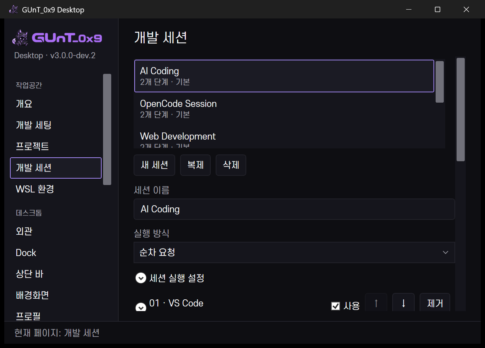 | 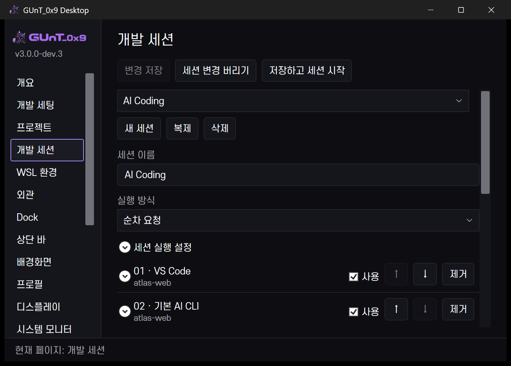 |

같은 175%·예제 프리셋·창 크기입니다. 원래 저장/시작은 본문 아래에 있었고, 이제 제목 아래에 유지됩니다. 편집 내용을 모두 첫 화면에 억지로 넣지 않고 본문은 계속 스크롤합니다. dev.2 화면은 보존 빌드를 이번 날짜에 다시 실행한 비교 자료입니다.

### 보조 편집창

| dev.2 — 프로젝트 설정 | dev.3 — 같은 설정 |
|---|---|
| 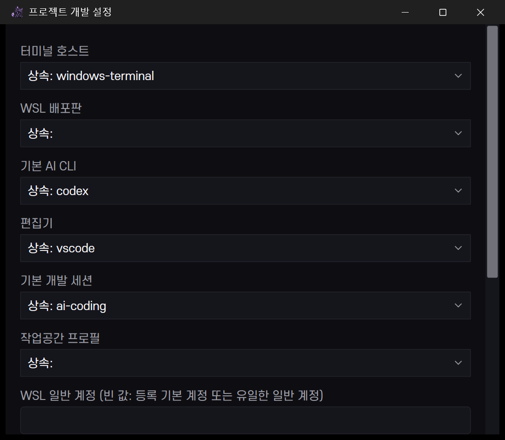 | 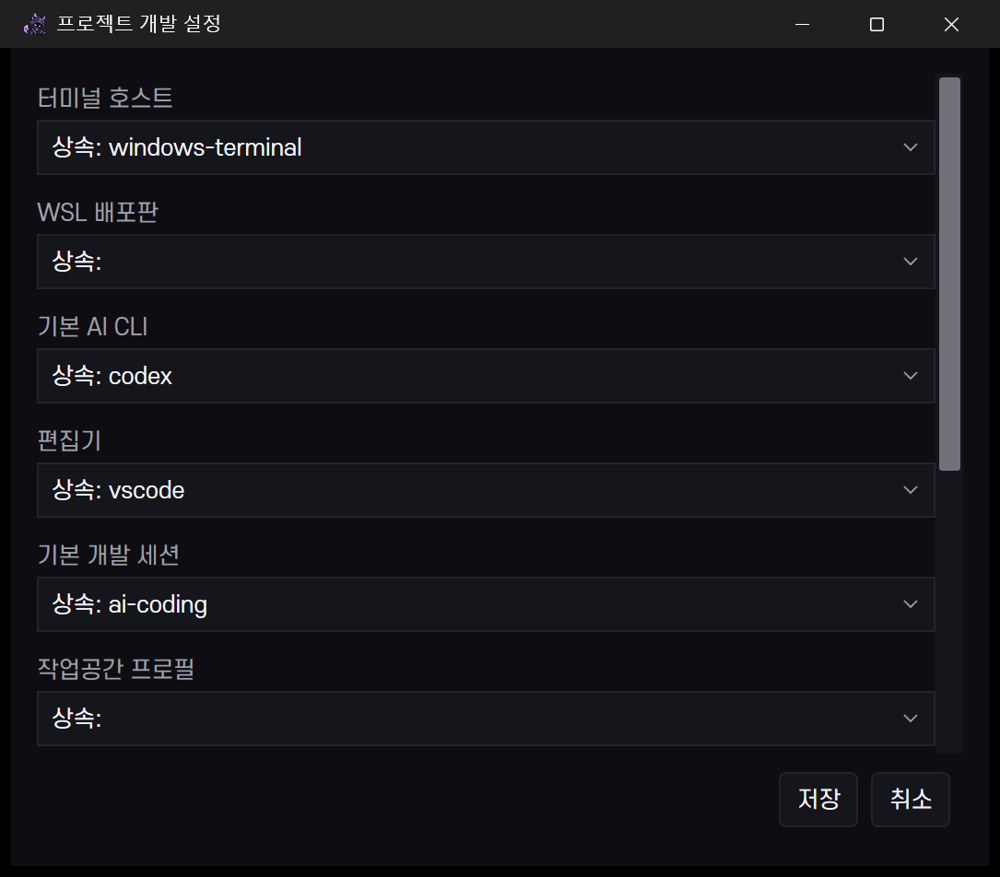 |

같은 780×560 DIP 소유 창에서 열었습니다. 실제 편집창 높이는 각 버전의 최대 높이 처리 때문에 약간 다릅니다. 저장·취소 위치와 스크롤 구조의 차이를 보여 주며 잘린 폼을 합성해 늘리지 않았습니다. 이 캡처에서는 설정값을 편집하거나 저장하지 않았습니다.

### 개발 탐색과 팔레트

| 개발 세팅 | 명령 팔레트 |
|---|---|
| 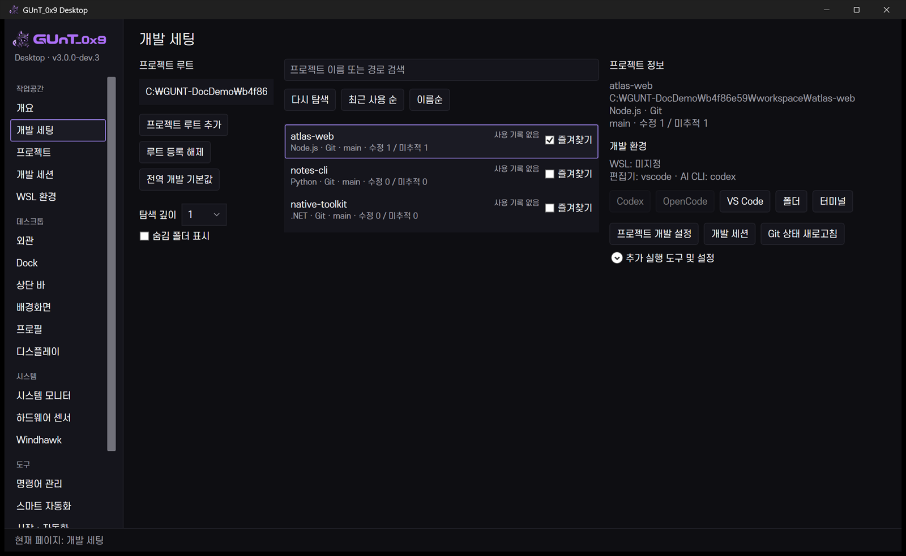 | 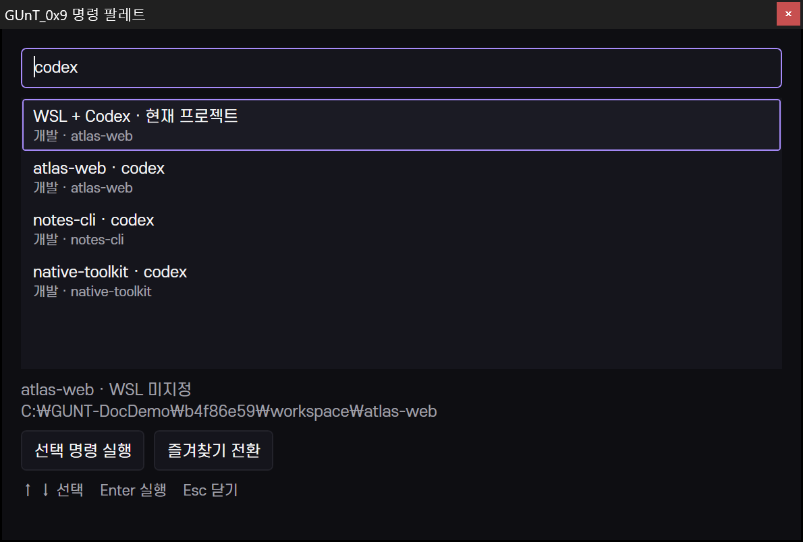 |

프로젝트는 이름·최근 사용과 유형·Git을 두 줄로 정리했습니다. 팔레트는 결과만 스크롤하고 실행·키 안내는 하단에 남습니다. WSL 미설정과 사용 기록 없음은 그대로 표시합니다. 이 화면에서 CLI 실행 성공을 검증한 것은 아닙니다.

최종 RGB PNG 6개를 다시 열어 검토했습니다. 예제 데이터로 개인정보를 배제해 불투명 가림은 필요하지 않았습니다. 개인 원본과 권리를 확인하지 못한 갤러리 썸네일은 공개하지 않습니다. 기존 13개 이미지 경로는 유지합니다.

[dev.3 보고](v30-dev3-report.md) · [수치·퇴행·제외 범위](v30-performance.md) · [화면 검증 범위](v30-screenshots.md) · [공개 manifest](images/releases/manifest.json)

## v3.0.0-dev.4 → dev.6 — GUNT Launchpad

**2026-10-20 개발 프리뷰.** dev.4는 네이티브 앱 발견·그리드·정리와 전역 키 기반, dev.5는 실제 포즈 10종과 선택형 테마, dev.6은 Settings/Workspace 분리·명령 통합·재열기 작업 절감을 구현했다. [기능과 사용법](v30-launchpad.md) · [실제 검증/한계](v30-launchpad-report.md).

| dev.4 — 첫 기반 | dev.6 — 관리 메뉴·정렬된 아이콘 영역 |
|---|---|
|  |  |

실제 175% Windows 창이다. dev.6은 940×620 DIP, dev.4는 940×590 DIP다. 같은 구조의 별도 공개용 카탈로그지만 dev.6은 App Paths 발견과 전체 앱의 GUNT 명령 기본 표시 범위를 바꿔 항목 구성이 다르다. 동일 픽셀/데이터 벤치마크로 읽지 않는다. 의미 없는 버튼 줄·반복 제목을 줄이고 높이와 줄 영역을 맞췄다. 긴 이름은 말줄임·툴팁/접근성 이름으로 제공하며 미해결 사항도 아래에 남긴다.

### 탐색과 정리

| 개발 | 유틸리티 폴더 |
|---|---|
| 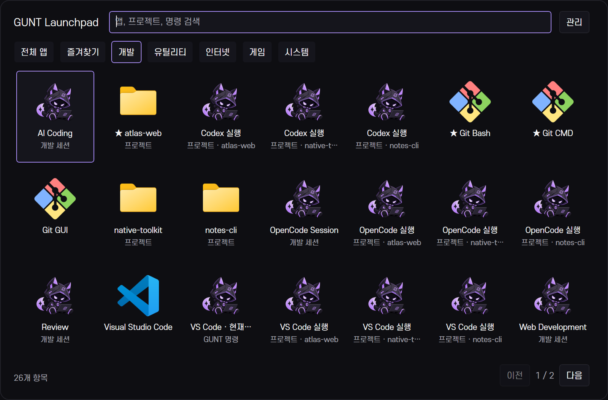 | 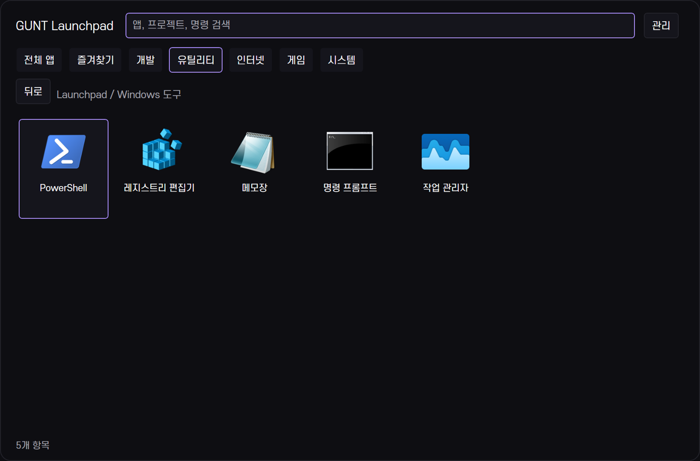 |

| 검색 | 즐겨찾기 |
|---|---|
| 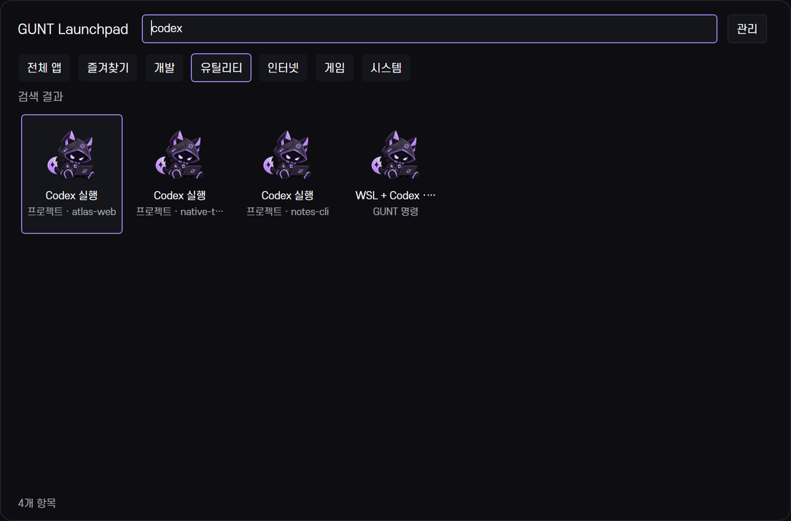 | 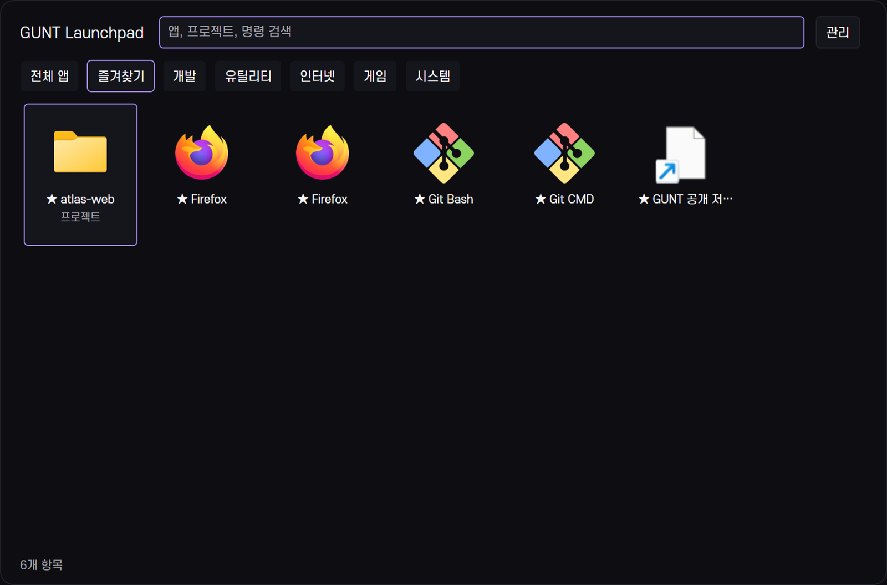 |

브라우저 중복 이름은 서로 다른 등록/실행 인수를 이름만 보고 합치지 않은 결과다. 앱 인식과 사용자 숨기기 기능을 보존했다. 공개 URL 바로가기는 웹사이트 아이콘의 기본 fallback으로 보인다. 이 상태를 완성된 전용 사이트 아이콘으로 주장하지 않는다.

### 마스코트와 사용자화

| 수동 포즈 지정 | 사용자화 대화상자 |
|---|---|
|  | 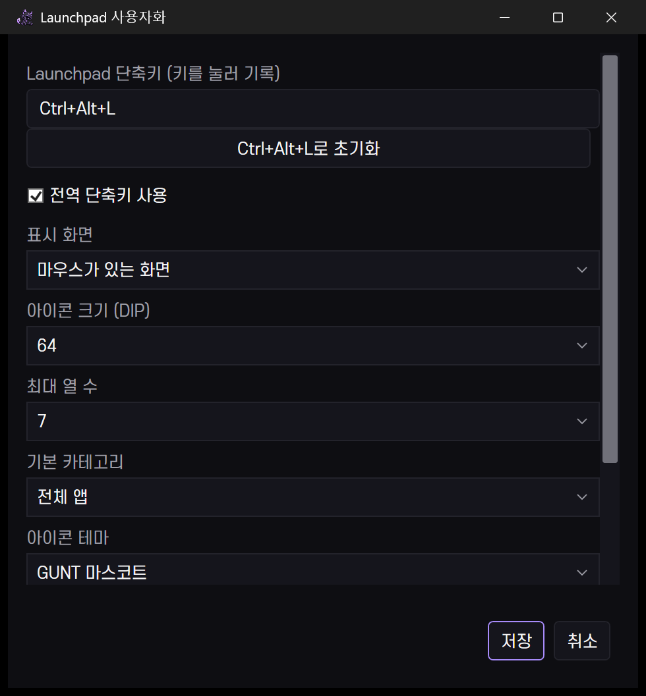 |

앱별 미지정 포즈는 원래 아이콘을 유지한다. 카테고리 포즈는 탐색 아이콘에만 적용한다. 대화상자의 아래 옵션은 본문 스크롤에서 접근하고 저장/취소는 고정한다. [승인 원본과 신규 파생 그림 9종](../assets/branding/mascot/README.md)의 출처를 구분한다.

### 세 인터페이스 영역

| GUNT Settings | GUNT Workspace |
|---|---|
| 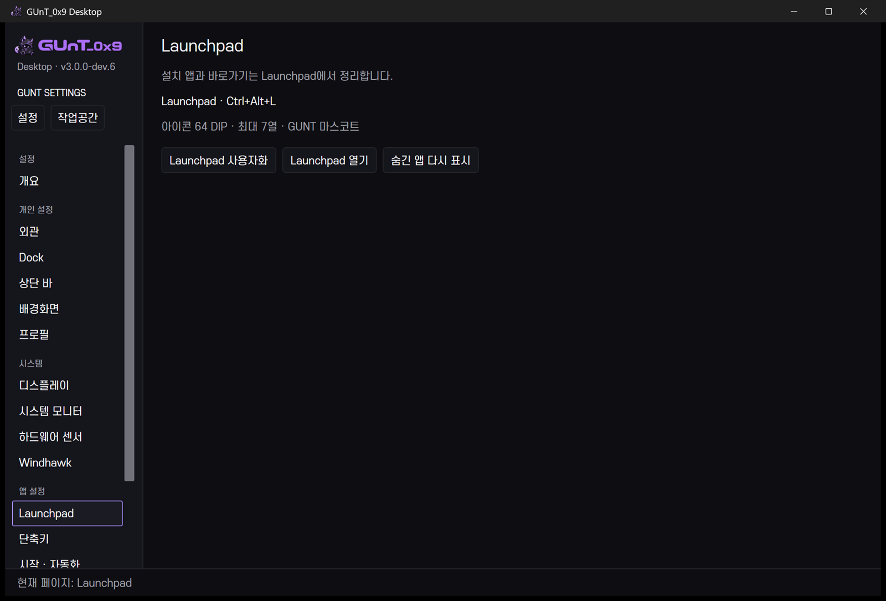 |  |

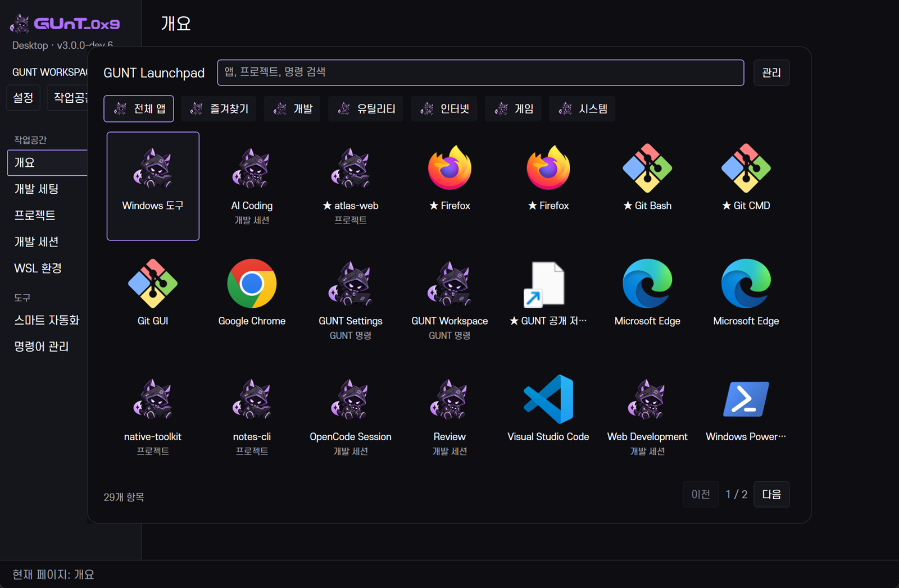

통합 장면은 실제 화면의 두 창이며 앱 화면을 합성한 이미지가 아니다. 사용자의 타사 배경·상단 바·알림을 피하려고 Workspace 클라이언트 영역으로 제한했다. 완전한 사용자 데스크톱 공개 캡처가 아니다.

### 검토 결과와 제한

최종 빌드의 원본 10개와 RGB export 10개를 각각 열어 한글·정렬·선택·잘림·경로를 확인했다. 공개 파일은 최대1600px이며 [출처/해시 목록](images/releases/manifest.json)에 기록한다. 초기 설정 개요의 실제 Lively ID와 초기 통합 캡처 테두리 밖 픽셀은 공개하지 않고 재캡처했다. 최종 별도 예제 상태는 픽셀 가림이 필요하지 않았다. 원본·캐시 인벤토리는 Git 제외다.

실제 입력으로 연결 화면 175%·150%와 음수 좌표/전경 선택을 확인했다. 긴 프로젝트 문맥 일부는 여전히 말줄임이며, 두 줄 이름/접근성 확대·100/125/200%·재연결·전체 스크린리더 검증은 남아 있다. [성능 수치와 예비 퇴행](v30-performance.md#launchpad-dev4--dev6--2026-10-20)은 시각 검토와 별도다.
