# GUnT_0x9 Desktop — 버전별 시각 기록

README에는 현재 제품과 대표 화면을 먼저 소개하고, 이 문서에 변화 과정과 전후 비교를 모읍니다. 이미지는 실제 Windows 앱에서 얻었으며 디자인 목업을 사용하지 않았습니다. 기존 공개 이미지는 안정적인 경로를 유지하고 중복 저장하지 않습니다.

## v2.4 — Desktop Foundation

변경 기록 날짜는 **2026-10-16**입니다. 한국어 상단 바·브랜딩, 실제 시간축 그래프·센서, 모니터/DPI 배치와 WPF 설정·복구 기반을 정리했습니다.

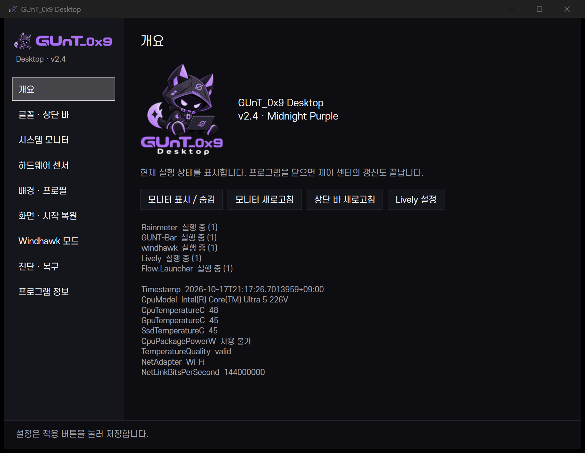

이 이미지는 v2.5 작업 전에 보존한 **v2.4 UI**이며 파일 이름은 기존 링크 때문에 유지합니다. 화면에 표시된 캡처 시점은 10월 17일입니다. 최근 UI 또는 현재 센서 상태를 뜻하지 않습니다. 사용자 배경이 포함된 과거 데스크톱 원본은 새 공개 쇼케이스에 재사용하지 않습니다.

[당시 보고](v24-report.md) · [검증](v24-testing.md) · [추가 수정](v24-flicker-mods-report.md) · [복구](v24-recovery.md)

## v2.5 — UX Overhaul

**2026-10-17.** 실제 상태 행·14개 목적지, 프로젝트 관리·Lively 갤러리, 프로필 미리보기와 미저장 설정 보호·복원을 정리했습니다. Dock 적용 보류는 당시 제한이며 현재도 유지됩니다.

| 개요 | 프로젝트 관리 |
|---|---|
| 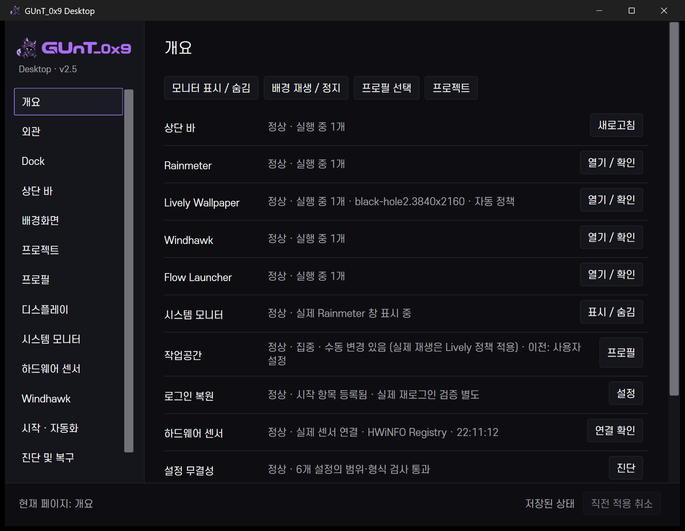 | 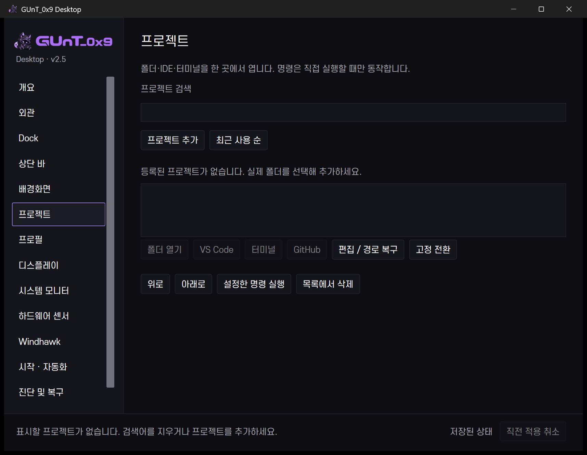 |

개인 프로젝트가 없는 실제 초기 상태입니다. 갤러리 기능은 당시 구현됐지만 로컬 배경 썸네일의 재배포 권한을 확인할 수 없어 이번 쇼케이스에 해당 이미지를 추가하지 않았습니다.

[UI 보고·v2.4 전후 비교](v25-ux-overhaul.md) · [검증](v25-testing.md) · [복구](v25-recovery.md)

## v2.6 — Developer Workspace

**2026-10-17–19 개발·검증 기록.** 프로젝트 루트 탐색·기본값 상속, WSL Codex/OpenCode, 세션·명령 팔레트·빠른 패널, 기본 중지 자동화를 통합했습니다. 외부 프로그램의 준비 완료와 실행 요청은 구분합니다.

| 개발 세팅 | 개발 세션 |
|---|---|
| 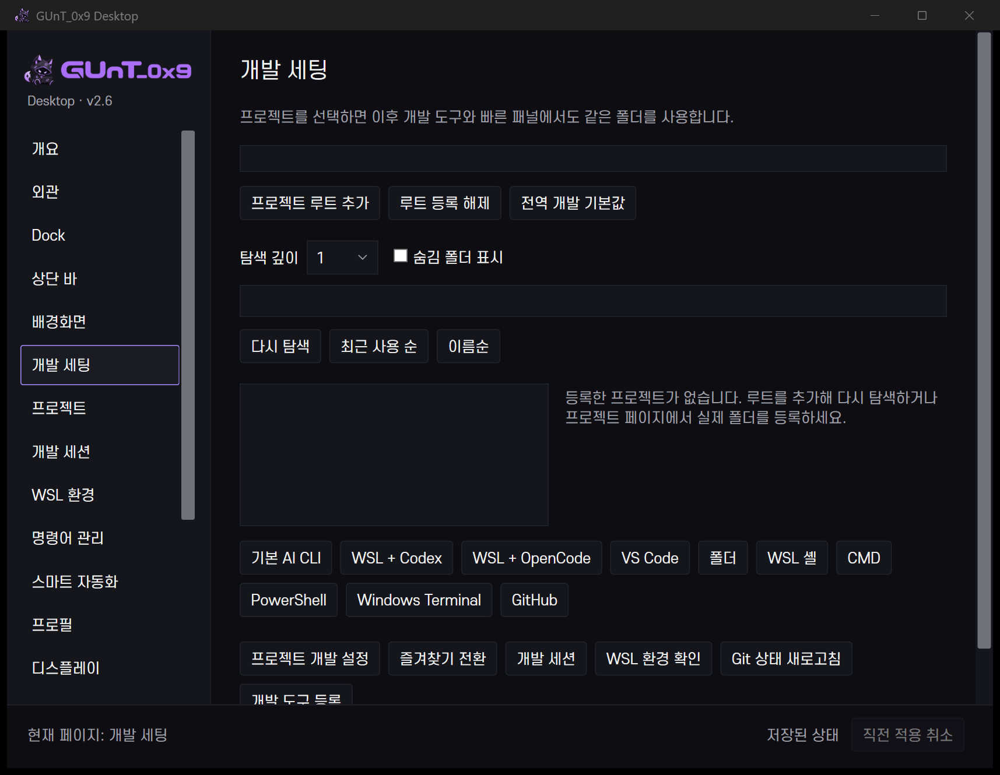 | 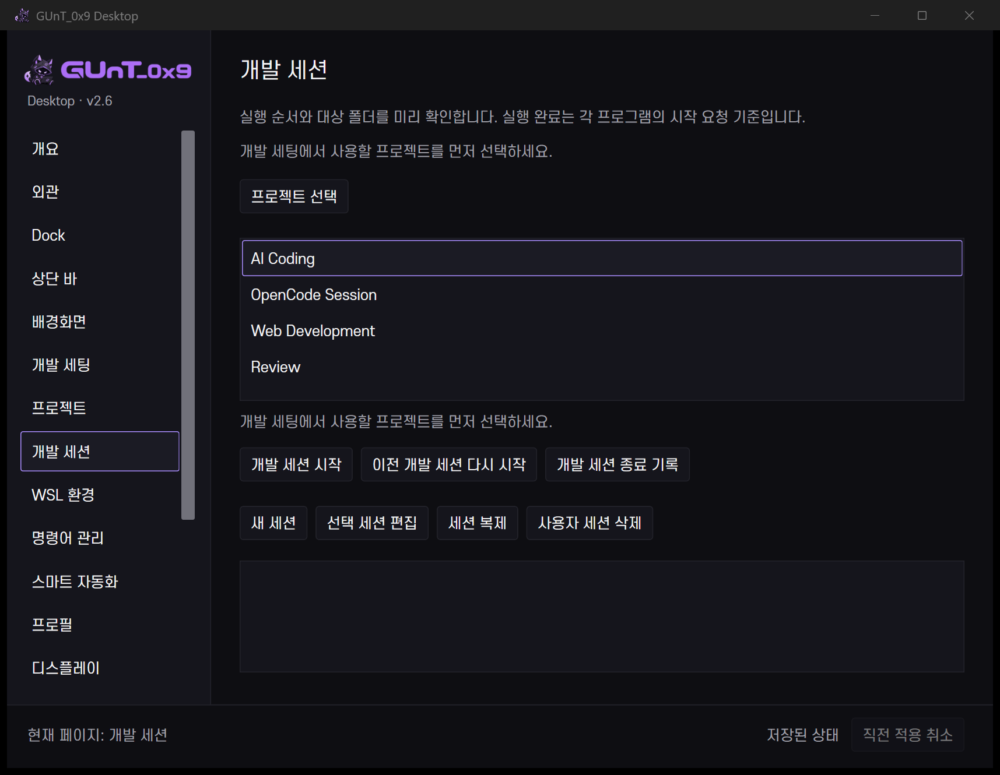 |

### 빠른 동작

| v2.6 명령 팔레트 | v2.6 빠른 패널 |
|---|---|
| 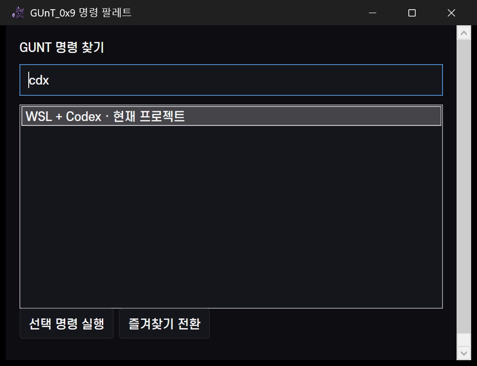 | 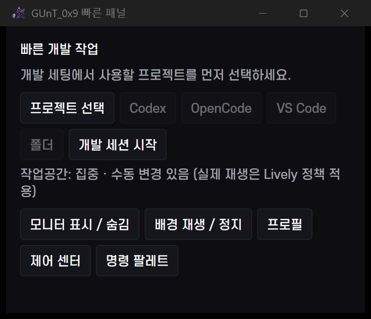 |

기존 공개 이미지를 그대로 참조했습니다. 실행 성공 화면을 그려 넣거나 개인 프로젝트를 보이게 하지 않았습니다. [전체 기존 화면·검증](v26-testing.md), [사용법](v26-developer-workspace.md), [세션](v26-development-sessions.md), [복구](v26-recovery.md)를 참고하세요.

## v3.0.0-dev.1 → v3.0.0-dev.2 비교

두 버전의 개발 기록 날짜는 **2026-10-19**입니다. dev.1은 공통 리소스·목적별 탐색·적응형 배치의 기반을 마련했고, dev.2는 프로젝트 행·본문 세션 편집·가상화 그리드를 보완했습니다.

다음 이미지는 **보존한 dev.1 빌드와 dev.2 빌드를 이번 문서 작업에서 다시 실행한 캡처**입니다. 각각 별도 문서용 설정과 같은 구조의 예제 프로젝트를 사용했으며 요청 창 크기는 1400×860 DIP, 실제 배율은 175%입니다. 당시 사용자 환경을 그대로 복원한 화면이나 성능 비교 자료로 해석하지 않습니다.

| dev.1 — 개발 세팅 | dev.2 — 개발 세팅 |
|---|---|
| 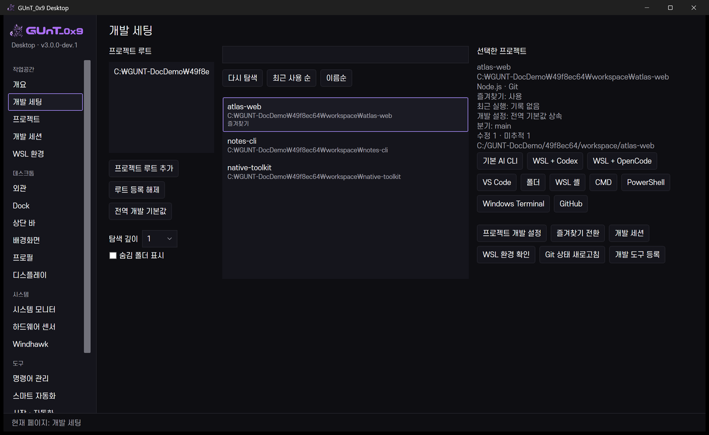 | 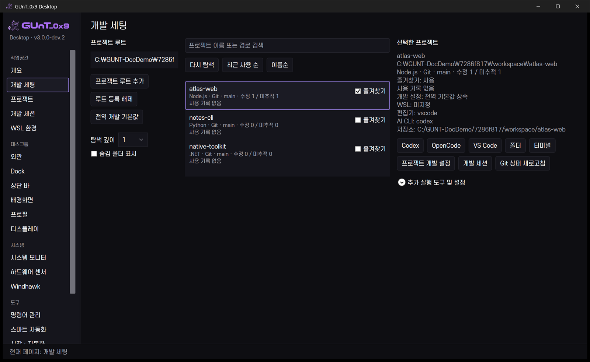 |

행 안에서 유형·Git 분기·수정/미추적 개수·즐겨찾기를 확인하고, 데이터 수에 따라 목록 높이를 줄였습니다. 보조 실행 도구는 접어 두고 기존 기능은 유지합니다. 예제 저장소는 실제 파일·Git 이력을 갖습니다. 최근 실행 기록은 만들지 않아 `사용 기록 없음`으로 보입니다.

| dev.1 — 세션 | dev.2 — 세션 |
|---|---|
| 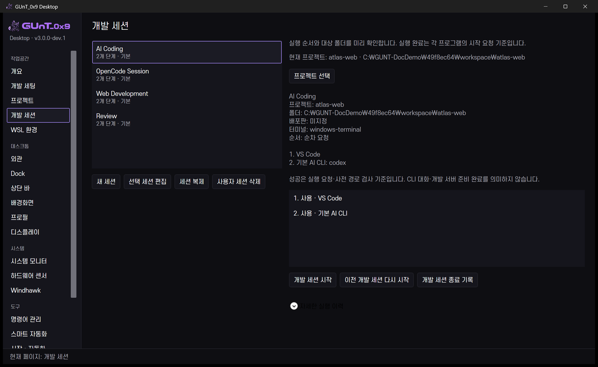 | 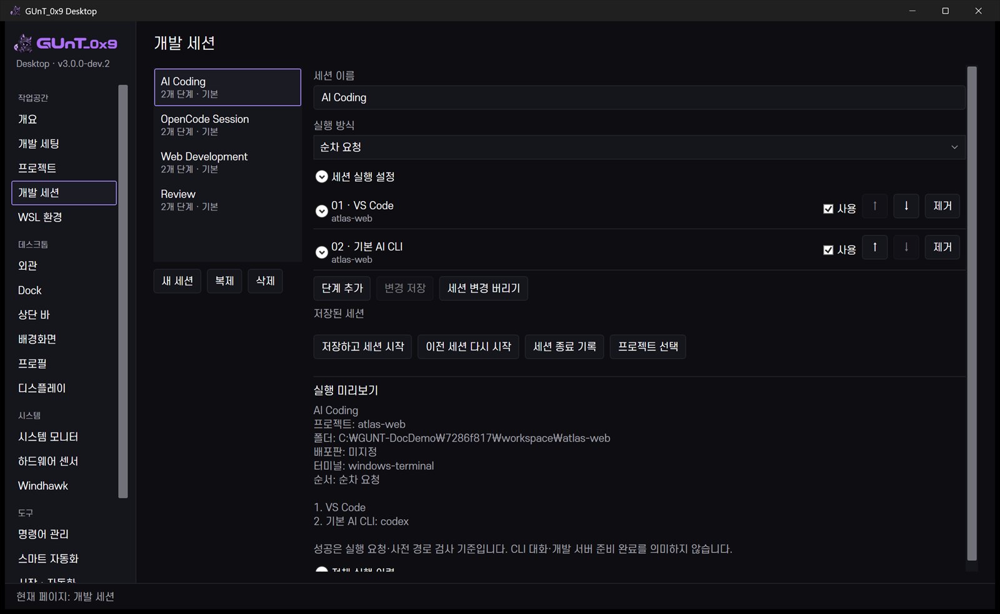 |

단계 속성을 본문에서 펼쳐 편집하고 순서·사용 여부·제거를 한곳에 모았습니다. 실행 미리보기와 전체 이력을 구분합니다. WSL 미지정과 준비되지 않은 상태를 성공으로 바꾸지 않았으며 이 캡처에서는 세션·CLI를 실행하지 않았습니다.

### dev.2 빠른 도구

| 명령 팔레트 | 빠른 패널 |
|---|---|
| 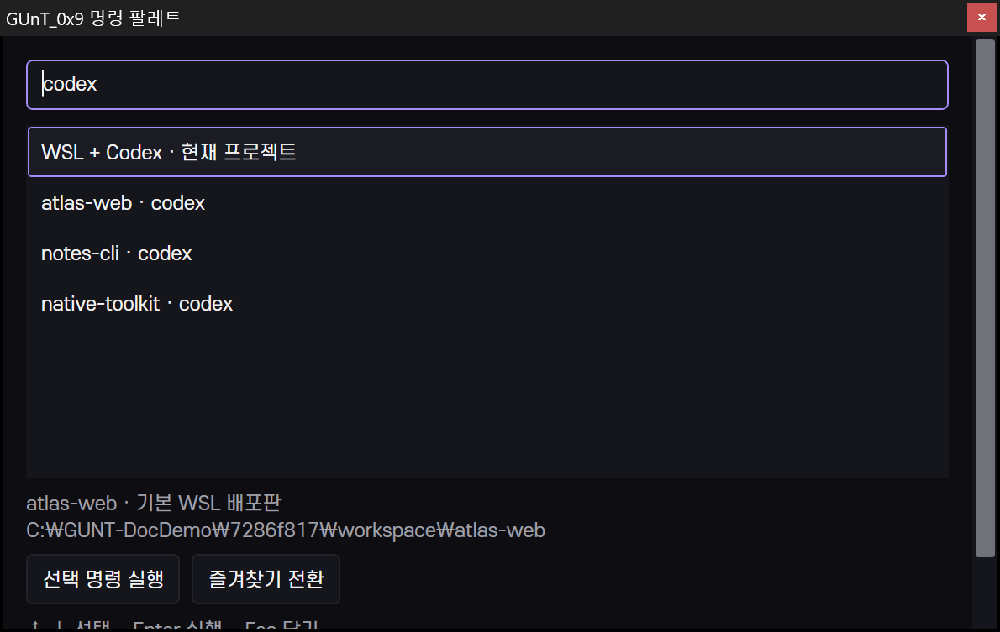 | 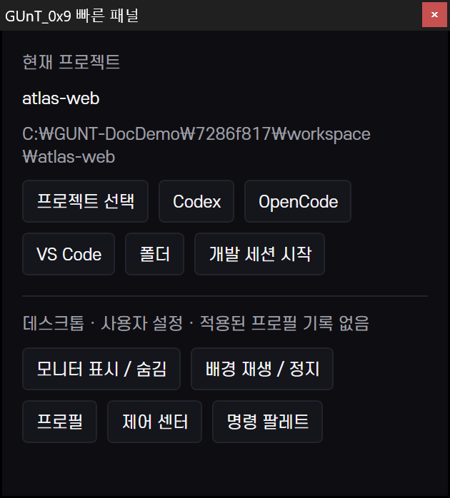 |

별칭 검색과 프로젝트 문맥을 보여 줍니다. 팔레트의 하단 단축키 안내는 현재 고정 높이에서 스크롤 아래에 일부 놓입니다. 화면을 합성해 이 제한을 숨기지 않았습니다.

### 검증·공개 범위

- 이전 dev.2 구현 검증: 실제 Windows 주요 화면 10개, 175%·연결 화면 1개, WPF 검사 29개와 OS 키 입력·상단 바 통합 검사 15개. [원래 범위](v30-screenshots.md)
- 이번 문서 캡처: 검증된 Windows 실행 파일을 사용하고 `C:\GUNT-DocDemo\...` 안에만 예제 설정을 생성. 사용자의 설정·작업공간·현재 배경을 변경하지 않음.
- 공개 PNG는 창만 캡처한 원본에서 별도 RGB 내보내기·메타데이터 제거·읽기 가능한 크기로 축소한 파일. 픽셀 가림은 필요하지 않았으며 개인 폴더·장치 ID·타사 배경을 포함하지 않음.
- 새 갤러리의 실제 구현·개인 환경 검증은 [UI 보고](v30-ui-overhaul.md)에 기록. 개인 경로와 타사 배경 썸네일이 포함된 원본은 공개하지 않음.
- 새 캡처에서 성능을 다시 측정한 것은 아님. 기존 수치·증가한 비용·제외 범위는 [성능 보고](v30-performance.md)를 참조.

[공개 이미지 manifest](images/releases/manifest.json)는 파일 해시·출처·버전·검토 상태를 기록합니다. 원본 경로와 개인 실행 로그는 Git에서 제외합니다. 자동 검사는 육안 개인정보 검토를 대신하지 않습니다.

[디자인 시스템](v30-ui-design-system.md) · [dev.2 구현](v30-ui-overhaul.md) · [후속 범위](v30-roadmap.md) · [다음 버전의 이미지 관리](readme-maintenance.md)
